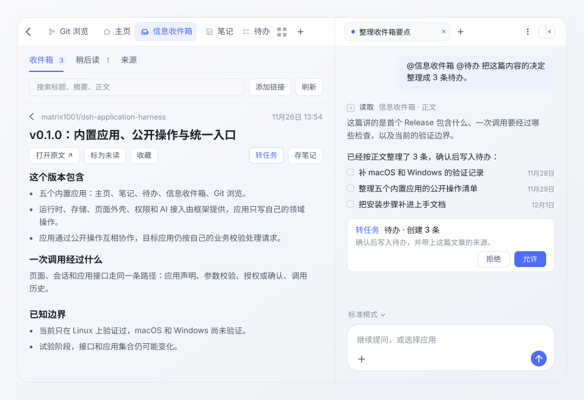
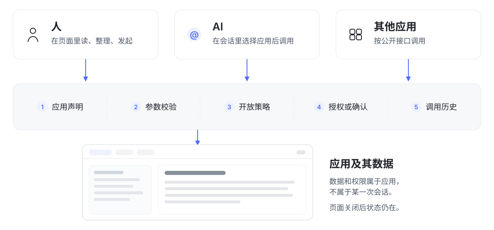

# Application Harness

[](https://github.com/matrix1001/dsh-application-harness/actions/workflows/ci.yml)
[](LICENSE)
[](https://github.com/deepseek-ai/deepseek-harness)
[](https://github.com/matrix1001/dsh-application-harness/releases)

## 让应用以同一种方式被人使用、被 AI 调用，并与其他应用协作

Application Harness 是一个面向人、AI 和应用协作的应用框架，让同一个应用同时拥有面向人的界面、面向 AI 的能力，以及面向其他应用的接口。

应用使用统一的操作模型、权限边界和生命周期。人通过界面使用它，AI 通过公开操作调用它，其他应用通过公开接口与它协作。

<p align="center">
  
</p>

左边的人在页面里读，右边的 AI 在同一个应用的应用区会话里做；需要写入时，入口统一向你确认。

> 非官方项目，当前处于试验阶段，接口和应用集合仍可能变化。欢迎试用、反馈和贡献。

## 从一条信息，到可以执行的工作

信息收件箱保存了一篇文章。人可以在页面里阅读和整理，AI 可以根据内容生成摘要和待办，收件箱、笔记和待办应用也可以通过公开操作互相协作。

1. **人使用应用**

   在信息收件箱中查看 GitHub Releases、RSS/Atom 或手动保存的链接。

2. **AI 使用应用**

   在普通会话里用 `@` 选择应用，让 AI 提取重点、总结内容或整理行动项。

   ```text
   @信息收件箱 @笔记 @待办 把这篇内容的决定整理成 3 条待办。
   ```

3. **应用协作**

   信息收件箱可以通过公开操作把内容保存为笔记，或者创建待办。目标应用仍按照自己的权限、确认和业务校验处理请求。

这条工作流里，页面、AI 和应用之间使用的是同一套应用能力。数据会留在应用自己的分区中，应用也可以在页面关闭或对话结束后继续保留状态。

## 和普通插件有什么不同

普通插件通常为 DSH 增加一个工具、面板或流程。Application Harness 关注的是应用本身如何被使用、调用和组合。

<p align="center">
  
</p>

| | 普通插件 | Application Harness |
|---|---|---|
| 定位 | 增加一个工具、面板或流程 | 提供应用运行与互联框架 |
| 面向人 | 使用插件提供的页面或入口 | 使用应用自己的界面和数据 |
| 面向 AI | 各自注册和维护工具 | 通过统一的公开操作调用应用 |
| 面向其他应用 | 通常彼此独立 | 通过公开操作组合工作流 |
| 生命周期 | 通常跟随会话或页面 | 应用拥有自己的运行状态和生命周期 |
| 边界 | 各自处理权限和确认 | 统一处理权限、确认和调用历史 |

写一个应用，就可以复用运行时、存储、页面外壳、权限和 AI 接入能力。应用作者可以把精力放在领域数据和业务操作上。

## 内置应用

内置应用共享同一个运行时、存储、权限和页面外壳，可以通过公开操作互相协作。

| 应用 | 用途 |
|---|---|
| 主页 | 查看各应用的当前状态与最近变化。 |
| 笔记 | 管理 Markdown、标签、搜索、附件和草稿，并支持 AI 总结。 |
| 待办 | 管理待办、截止日、优先级和今天视图。 |
| 信息收件箱 | 汇总 GitHub Releases、RSS/Atom 与手动链接，稍后读、收藏并转为待办或笔记。 |
| Git 浏览 | 只读查看仓库状态、历史与差异。 |

### 权限与连接

<p align="center">
  
</p>

截图来自隔离实例和合成示例内容，不包含真实业务数据。

## 同一个应用，三种使用者

| 入口 | 谁在用 | 能访问什么 |
|---|---|---|
| 应用页面 | 人 | 当前应用的界面和数据 |
| 普通会话 `@` | 会话 AI | 本轮明确选择的应用 |
| 应用区会话 | 会话 AI | 所有应用和当前页面上下文 |
| 公开操作 | 其他应用 | 目标应用声明开放的能力 |

普通会话里输入 `@` 并选择应用后，AI 才能在本轮调用它的公开操作。同一轮可以选择多个应用，下一轮需要重新选择。应用区会话可以直接使用所有应用，并带上当前页面上下文。

四种入口最终都遵循同一条调用路径，包括应用声明、参数校验、开放策略、用户授权或确认，以及调用历史。页面和 AI 看到同一份数据，也受同一套权限约束。

## 安装

### 安装已发布版本

从 GitHub Releases 安装时，需要使用独立的 DSH profile，避免影响日常开发环境。

```bash
export DSH_HOME="$HOME/.dsh-application-harness-release"

dsh --profile application-harness --from-default-profile web --dump-config

dsh plugin --profile application-harness add \
  https://github.com/matrix1001/dsh-application-harness/releases/download/v0.1.1/matrix1001-dsh-application-harness-0.1.1.tgz

dsh --profile application-harness
```

当前 Release `0.1.1` 基于 DSH `0.2.3-alpha.2`，与源码线一致。校验和、升级、卸载与数据路径见[操作手册](docs/DEVELOPMENT.md#3-安装-release)。

### 从源码运行

从源码运行本仓需要 DSH `0.2.3-alpha.2`、Node.js `^24.22.3 || >=26.13.1` 和 pnpm。当前已在 Linux 上验证，macOS 和 Windows 尚未验证。

第一次运行和开发流程见[上手](docs/START.md)。

## 文档

- 开始使用：[上手](docs/START.md)　第一次运行、开发和验证
- 开发应用：[应用开发指南](docs/APPLICATION_DEVELOPMENT.md)、[架构总览](docs/ARCHITECTURE.md)
- 查契约：[参考](docs/REFERENCE.md)　符号、错误码、宿主状态文件
- 运维与发布：[开发、安装与发布操作](docs/DEVELOPMENT.md)
- 全部文档：[文档地图](docs/README.md)　唯一索引与事实归属

修改仓库或选择验证范围前，请先阅读[工程规则](AGENTS.md)。

## 许可证

本项目使用 [MIT](LICENSE) 许可证。其中的 DeepSeek Harness 源码快照与 Typert 构建壳的来源、版本和许可证见 [THIRD_PARTY_NOTICES.md](THIRD_PARTY_NOTICES.md)。
