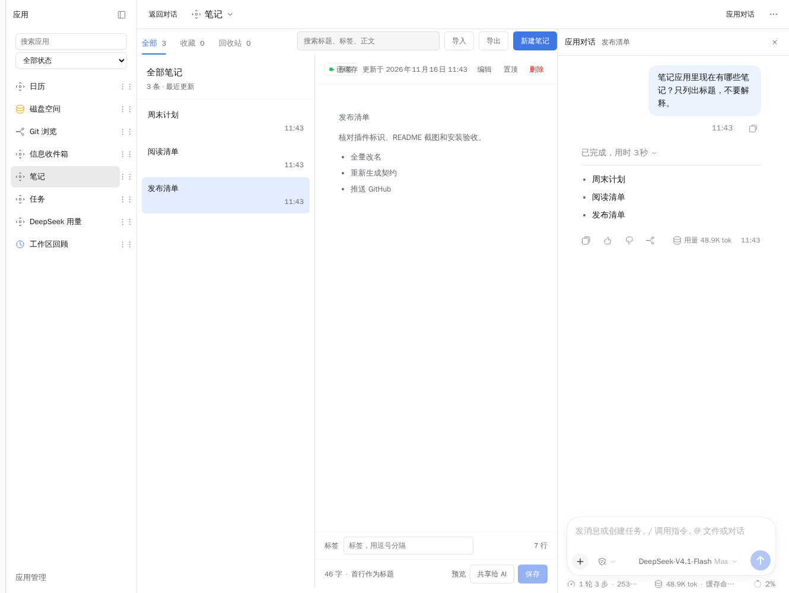
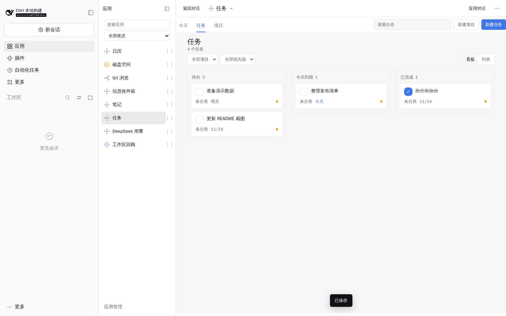
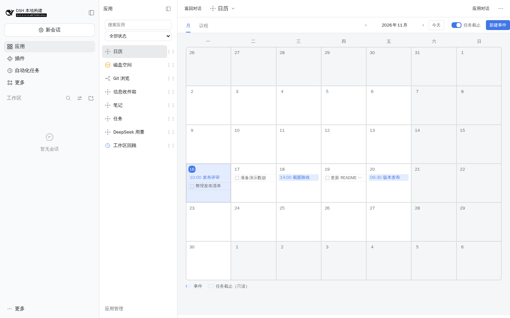
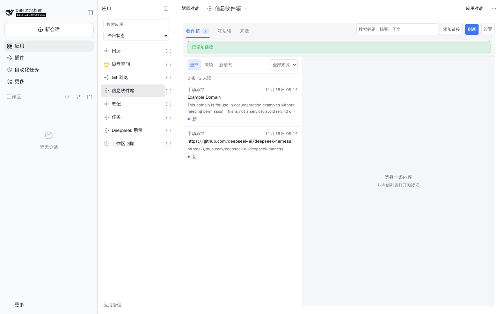
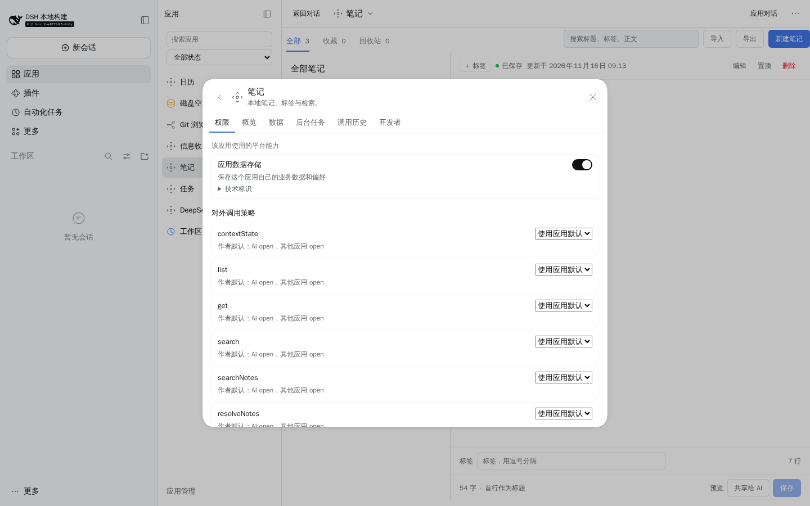
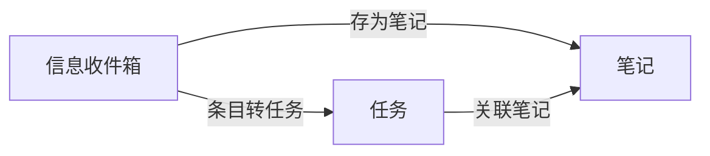

# Application Harness

[](https://github.com/matrix1001/dsh-application-harness/actions/workflows/ci.yml)
[](LICENSE)
[](https://github.com/deepseek-ai/deepseek-harness)
[](https://github.com/matrix1001/dsh-application-harness/releases)

### 一个应用，三种使用者：人、AI、其他应用

**让应用同时成为界面、能力和接口。**

应用不该只为一种使用者设计。Application Harness 是 DeepSeek Harness 的应用运行与互联层：应用有自己的数据和生命周期；同一套公开操作同时向人、AI 和其他应用开放。普通会话可以用 `@` 把应用带入本轮，应用区的应用对话可以使用全部应用，应用之间也能通过这套操作互相调用。Harness 不替应用做业务，它把应用托起来，让它们共享运行、数据和权限边界。

[和别的 DSH 应用有什么不同](#和别的-dsh-应用有什么不同) · [内置应用](#内置应用) · [它怎么工作](#它怎么工作) · [安装](#安装) · [文档](#文档)

One application, three kinds of users: humans, AI, and other applications. Application Harness makes the same application a UI for humans, a capability for AI, and an interface for other applications — with one operation surface, one permission model, and one lifecycle.

<p align="center">
  
</p>

> 非官方项目，当前处于试验阶段，不保证可靠性，欢迎接盘。

## 和别的 DSH 应用有什么不同

常见的 DSH 插件是给对话加一个工具、面板或流程；Application Harness 给 DSH 加一层**应用运行与互联层**。

| | 常见的单点插件 | Application Harness |
|---|---|---|
| 定位 | 给 DSH 加一个工具、面板或流程 | 给 DSH 加一层应用运行与互联层 |
| 使用者 | 人和会话中的 AI | 人、AI 和其他应用共用同一套公开操作 |
| 生命周期 | 大多跟随会话或页面 | 应用独立运行；关页面、结束对话都不停 |
| 数据 | 会话、插件配置或各自的文件 | 应用自己的数据分区；统一存储、导出、恢复 |
| AI 接入 | 每个插件各自注册工具 | 所有应用共用 `applications` 操作面；权限、确认、历史一致 |
| 应用协作 | 通常各自独立 | 应用通过公开操作互相调用 |
| 扩展 | 一次加一个功能 | 写一个应用 = 声明 + 可选页面，复用运行时、存储和权限 |

所以 AI 不需要为每个应用学一套新工具，应用也不需要为 AI 重写一套接口；人、AI、其他应用看到的是同一套操作。这也是它和“给 DSH 加一个功能”的项目最根本的区别。

## 内置应用

8 个应用共享同一个运行时、存储、权限和页面外壳，不是 8 个互不相干的插件。

| 应用 | 用途 |
|---|---|
| 笔记 | 快速记录、Markdown 编辑、标签与搜索。 |
| 任务 | 项目、任务、截止日与今天视图。 |
| 日历 | 月/议程视图，任务截止日叠加。 |
| 信息收件箱 | 汇总 GitHub、RSS、网页与手动链接，稍后读、收藏并转为任务或笔记。 |
| DeepSeek 用量 | 按日、模型与 API Key 查看用量和消费。 |
| 磁盘空间 | 扫描目录、定位大文件和重复文件、查看回收站占用。 |
| Git 浏览 | 只读查看仓库状态、历史与差异。 |
| 工作区回顾 | 汇总多个 coding agent 会话，生成工作区回顾。 |

| 任务 | 日历 |
|---|---|
|  |  |

| 信息收件箱 | 权限管理 |
|---|---|
|  |  |

截图使用隔离实例和合成数据，不包含真实业务数据。

## 它怎么工作

| 入口 | 谁在用 | 能访问什么 | 时效 |
|---|---|---|---|
| 应用页面 | 人 | 当前应用 | 页面关闭不影响应用 |
| **普通会话 `@`** | 会话 AI | 本轮 `@` 的应用，可多个 | 只在本轮；下一轮重新 `@` |
| 应用区的应用对话 | 会话 AI | 所有应用 + 当前页面上下文 | 应用区专属会话 |
| 公开操作 | 其他应用 | 已声明的跨应用操作 | 按目标应用权限与确认 |

四种入口最终都走同一条调用路径：应用声明、参数、开放策略、用户授权或确认、调用历史。页面和 AI 看到同一份数据，也受同一套权限约束。

### 普通会话：@ 应用

在普通会话里输入 `@`，选择应用。消息发送后，AI 才能在本轮调用它的公开操作；同一轮可以带多个应用，下一轮需要重新 `@`。

```text
@笔记 @任务 把这篇笔记里的决定整理成 3 条待办。
```

`@` 只把应用加入本轮访问范围，不提供页面上下文，也不代替操作确认。应用区的应用对话不用逐个 `@`，可以直接使用所有应用，并带上当前页面上下文。

### 应用之间：公开操作



收件箱的“转任务”不是复制粘贴：它通过公开操作调用任务应用。普通会话里只 `@` 了收件箱，也不需要额外 `@` 任务；下游调用仍按任务的开放声明、用户策略、确认和业务校验独立检查。

首次使用需要在权限页授权相应应用能力和跨应用操作；写操作按应用作者默认和你的策略执行，需要确认时会等待你决定。

## 安装

需要 DSH `>=0.2.2-rc.2 <0.3.0-0`、Node.js `>=24.9.0` 和 pnpm。当前在 Linux 上验证；macOS 和 Windows 尚未验证。首个公开版本是 `0.1.0`。

```bash
# 1. 创建独立 profile（只需一次）
dsh --profile application-harness --from-default-profile web --dump-config

# 2. 安装（把版本换成 Release 页面上的版本）
dsh plugin --profile application-harness add \
  https://github.com/matrix1001/dsh-application-harness/releases/download/v0.1.0/matrix1001-dsh-application-harness-0.1.0.tgz

# 3. 启动
dsh --profile application-harness
```

<details>
<summary>升级、卸载与校验和</summary>

升级是换一个新版本 asset URL，重新执行 `dsh plugin add`；旧版本资产保留在 GitHub Releases。

```bash
# 卸载插件；业务数据不会随卸载删除
dsh plugin --profile application-harness remove @matrix1001/dsh-application-harness
```

Release 同时提供 `matrix1001-dsh-application-harness-<version>.tgz.sha256`。Linux 用 `sha256sum -c`，macOS 用 `shasum -a 256 -c` 核对。业务数据默认在 `$DSH_HOME/application-harness/`，卸载不会删除。

</details>


## 文档

| 你想做什么 | 阅读入口 |
|---|---|
| 创建应用、接入界面和部署、编写测试 | [应用开发指南](docs/APPLICATION_DEVELOPMENT.md) |
| 理解系统组成、模块依赖、当前实现与验收边界 | [架构总览](docs/ARCHITECTURE.md) · [实现细节](docs/architecture/11-实现与验收.md) |
| 阅读已批准的目标设计（协议、权限、运行、页面、互联等专题） | [文档地图](docs/README.md) |
| 修改仓库、更新平台或选择验证范围 | [工程规则](AGENTS.md) |

## 许可证

本项目为 [MIT](LICENSE)。其中的 DeepSeek Harness 源码快照与 Typert 构建壳来源、版本和许可证见 [THIRD_PARTY_NOTICES.md](THIRD_PARTY_NOTICES.md)。
