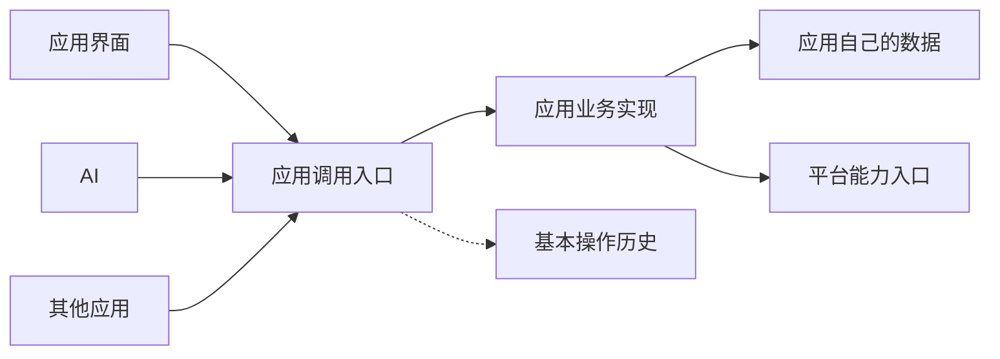

# Application Harness 架构总览

本文只回答三件事：系统由什么组成、模块依赖往哪边走、细节该读哪一篇。具体规则、当前实现细节和验收边界分别在[设计专题](architecture/1-总体设计.md)和[实现细节与验收](architecture/11-实现与验收.md)中，本文不重复。

使用入口见 [README](../README.md)，接入步骤见[应用开发指南](APPLICATION_DEVELOPMENT.md)，文档导航见[文档地图](README.md)，修改与验证规则见 [AGENTS](../AGENTS.md)。

## 1. 定位与设计边界

Application Harness 建立在 DeepSeek Harness 之上，围绕**完整应用**组织开发和使用：人通过界面使用应用，AI 和其他应用通过同一套公开操作使用同一份业务能力。

第一阶段面向个人、本机、可信应用作者：多人协作、云端托管、应用市场和任意第三方代码的安全沙箱不作为设计前提。应用以本仓内开发的新应用为主，可以自行调用外部 API、命令行等；平台不为接入任意外部软件另建通用抽象。

## 2. 系统组成与依赖关系

| 部分 | 职责 |
|---|---|
| DeepSeek Harness | 模型、对话、工具调用、插件、任务与界面基础能力 |
| Application Harness | 组织和运行应用，提供应用发现、界面接入、操作调用、权限管理和基本操作历史 |
| 应用 | 实现业务、管理数据、公开操作、按需提供界面，并调用其他应用或平台能力 |

应用决定调用什么、何时调用以及如何处理结果；平台负责找到目标、检查声明和权限并执行调用，不替应用决定业务流程。复用平台能力时不因应用需要而默认新增一层包装服务。

| 能力 | 复用方式与本项目职责 |
|---|---|
| 插件与服务 | 用 Cordis 注册应用、注入依赖和清理资源；本项目补充应用身份、可调用状态和在途操作管理 |
| AI 工具 | 用平台 Tools 注册向 AI 开放的操作与参数/结果 schema；执行和取消由显式执行器插件（native / PTC）按 Agent 作用域提供；工具定义从应用声明生成 |
| 客户端通信 | 用 Connection 与 Typert Remote 承载调用和订阅；不另建传输层。非 owner Peer 的方法级访问控制由平台 `RemoteAccessService` 负责，应用授权表不能替代它 |
| 界面 | 用 UI Slots、UI Renderer 和 Layout 接入应用页面；主面板独立于会话 |
| 模型与凭据 | 用 LLM 和 Credentials；本项目只补应用身份和权限检查，不复制模型适配器或凭据系统 |
| 存储与设置 | 业务数据由本项目的统一存储承载（见[数据实现](architecture/11-实现与验收.md#1-数据与一致性)）；插件与运行配置用平台的 Settings；两者的含义仍由各自负责方定义 |
| 审批与任务 | 会话审批、会话任务不等同于应用授权和应用后台任务（见第 4、6 节）。应用长任务可镜像为平台 Jobs，业务状态仍以应用自己的持久记录为真源 |

应用调用入口负责参数检查、权限判断和结果交付；平台能力入口按应用身份检查；调用结果沿原入口返回。基本操作历史是独立支路，记录故障不阻断业务调用。图中是逻辑职责，不要求每一项都成为独立的包或服务。

### 2.1 模块与依赖方向

| 模块 | 职责与依赖边界 |
|---|---|
| [runtime](../packages/application/runtime/src/index.ts) | 应用声明、注册、调用、权限判断、生命周期和任务契约；不依赖接入层、客户端或具体应用 |
| [host-bridge](../packages/application/host-bridge/src/index.ts) | 宿主通信、授权与历史持久化、数据管理、模型和 secret 接入；依赖运行时 |
| [tool-bridge](../packages/application/tool-bridge/src/index.ts) / [context](../packages/application/context/src/index.ts) | 将应用操作和引用接入平台工具与会话；复用运行时契约，不另定义业务操作 |
| [store](../packages/application/store/src/index.ts) / [http](../packages/application/http/src/index.ts) | 存储和网络接入；与其他接入模块可协作，不反向依赖客户端 |
| [applications](../packages/client/applications/src/client/index.ts) | 应用外壳、视图注册、会话与导航；通过平台侧栏的面板入口与宿主公开通信面协作 |
| [chrome](../packages/client/chrome/src/index.tsx) / 各应用视图 | 共享界面组件与业务页面；不值导入宿主实现，跨插件值协作使用平台服务 |
| [应用](../packages/examples) / [bundle](../packages/bundle/app-harness/deployment.yml) | 应用依赖运行时及接入能力；bundle 组合宿主和客户端，应用之间只通过公开操作协作 |

客户端可以引用运行时类型及接入层的浏览器通信契约，但不能把宿主实现打入浏览器。共享静态界面库可按声明内联；它与跨插件服务的共享身份不同。TypeScript 项目引用和包依赖必须完整，分层检查见 [verify-layer-deps.mjs](../scripts/verify-layer-deps.mjs)。检查通过不替代上述业务边界。

## 3. 设计与实现导航

| 文档 | 内容 |
|---|---|
| [设计专题](architecture/1-总体设计.md) | 目标设计：总体、协议、权限、运行、能力、互联、页面、会话、委托、开发支持、开发与发布 |
| [实现细节与验收](architecture/11-实现与验收.md) | 当前数据、生命周期、界面实现、错误/历史和验收边界 |
| [开发、安装与发布](architecture/12-开发安装与发布.md) | 开发线、自包含 tarball 安装、版本与 Release 发布 |
| [应用开发指南](APPLICATION_DEVELOPMENT.md) | 面向应用作者的任务步骤和示例 |

设计专题说明“应该怎样”，实现细节说明“现在怎样”，应用开发指南说明“怎么用”。发生冲突时按[文档地图](README.md#事实优先级)处理。

## 4. 当前实现范围与未完成

已具备的主干能力：

- 应用声明、注册、调用、权限策略、单次确认、对象引用、事件订阅；
- 页面服务、草稿共享、普通会话 `@`、应用专用会话、开发会话；
- 统一管理页、模型选择/用量/限制、凭据、进程与能力摘要；
- 生命周期、维护暂停、后台任务、数据备份与恢复；
- 部署组合、脚手架、隔离验证实例。

尚未实现或只实现了一部分的能力：

| 项目 | 当前状态 | 边界 |
|---|---|---|
| 多应用专用会话、每应用多个开发会话 | 未实现 | 宿主当前只保存一个应用专用会话和一个开发会话绑定；设计允许按应用创建多个 |
| 会话委托 | 未实现 | [9. 会话委托](architecture/9-会话委托.md)定义了首版简单交接，但尚未接入宿主/工具入口 |
| 候选版本加载与晋升 | 部分实现 | `validate:app` 只验证当前构建的隔离实例；没有候选包加载、版本比较或晋升到日常部署的产品入口 |
| 页面关闭广播 | 部分实现 | 页面实例变化会使等待中的页面/草稿命令失败，但没有向其他客户端广播页面关闭事件 |
| 运行时安装/更新/卸载 | 按设计不提供 | 第一版只从部署组合加载；更新/卸载在部署层完成，运行时没有安装器或回退历史 |
| 生命周期失败、备份恢复的完整浏览器验收 | 未验证 | 单元/集成测试覆盖；没有逐状态的真实浏览器验收脚本 |

明确的非目标（不属于本次缺口）：多用户、应用市场、任意第三方代码沙箱、应用级网络代理、`FileRef`、通用队列/自动重试、多版本并存、预算计费。

## 5. 验收

验收行为、必须通过的真实链路和暂不覆盖的边界见[实现细节与验收的第 5 节](architecture/11-实现与验收.md#5-验收边界)。每次验证的命令、范围和未覆盖项在对话或提交说明中报告，不在文档里保存某次验收历史。
