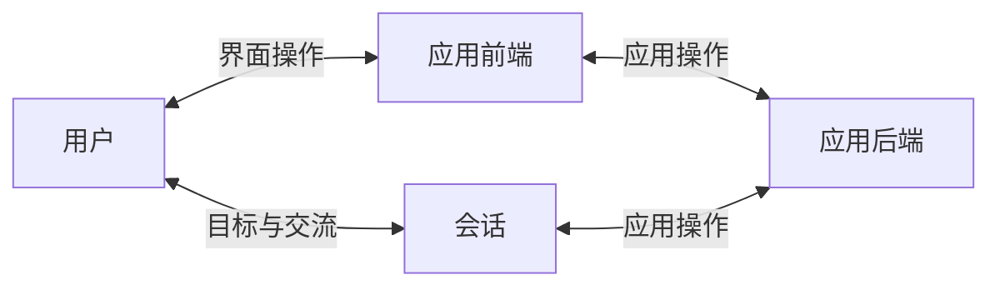
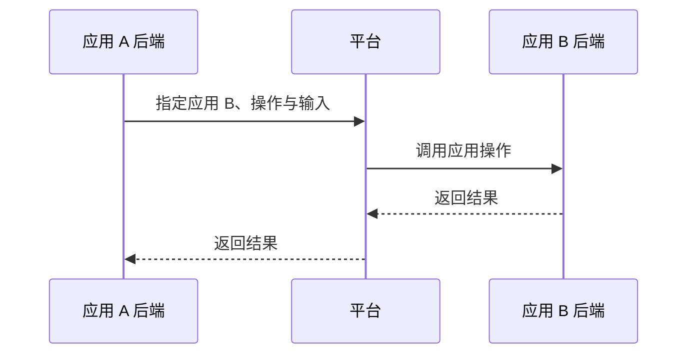
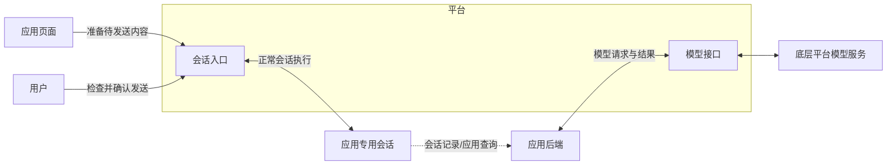
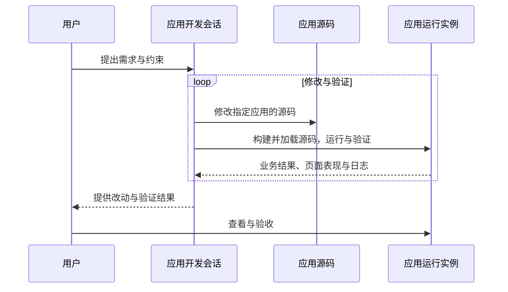

# Application Harness 总体设计

Application Harness 是基于 DeepSeek Harness 插件体系构建的应用平台，以插件组合交付。它为应用的开发、运行与互联提供共同基础，让用户和会话共同创建、使用和持续改进应用，降低重复建设与跨应用协作的成本。

本套文档描述**目标设计与已确认规则**。具体实现状态、当前约束和未覆盖项见[实现细节与验收](11-实现与验收.md)；源码和测试决定当前行为，不以旧实现覆盖已确认的新设计。未涉及的工程约束继续遵循 [AGENTS](../../AGENTS.md) 和现有文档。编号表达阅读与设计重要性，不是实施顺序。

## 目标与范围

- 用户、会话和其他应用都是正式使用方，共用应用业务能力与数据，保留各自的交互方式和权限。
- 应用可以小到一个查询工具，也可以拥有完整界面、数据与后台工作；不要求依赖模型。
- 支持托管应用。应用可以按需封装外部 API、本机服务或其他系统的部分能力；整体默认交付面向本机、单用户、可信应用，优先提供低成本的托管开发体验。

使用模型与 DeepSeek Harness 对齐，以用户为使用和管理主体。第一版只支持用户访问 Application Harness 的应用页面、应用操作、业务数据、订阅和平台管理；底层平台可以存在共享会话，但共享访问者不因此获得 Application Harness 的访问主体身份。第一版不另建多用户账号、组织或角色体系；后续支持共享访问时，须先定义独立的访问主体、数据授权和审计规则，不能仅复用底层共享会话。

第一版只面向单用户，不提供应用内多账户、组织或角色模型。后续用户模型随底层平台能力与实际需求演进。本设计不引入租户系统、应用市场、云端部署或任意代码的安全沙箱。

第一版的应用来源是由部署组合加载或用户开发的可信代码。应用按底层插件的信任边界运行；声明校验、能力授权和调用确认用于约束误用与业务访问，不能隔离恶意或有缺陷的同进程代码。应用接入外部系统时自行处理外部协议、数据转换和业务错误，平台只提供应用声明并已获授权的能力。将来支持不可信第三方应用时，还须另设安装来源、签名、隔离和多用户安全模型。

首版范围只覆盖应用运行所需的共同边界：应用操作、页面与会话入口、明确的跨应用调用和刷新提示、标准存储、模型／网络／凭据／进程能力，以及应用自有后台任务的生命周期控制。业务流程、业务重试、定时逻辑、预算和补偿由应用或会话负责。平台不提供通用编排器、可靠队列、跨应用事务与全局回滚、平台级预算／计费／配额、跨应用共享文件系统或永久转交、通用表单生成、全局审计回放等基础设施；后续需求须有真实使用场景后再单独设计。

## 与 DeepSeek Harness 的关系

| 层次 | 职责 |
|---|---|
| DeepSeek Harness（底层平台） | 插件运行、会话、模型、工具执行、审批、凭据、通信与界面基础设施 |
| Application Harness（平台） | 应用身份与运行、统一协议、权限、互联、页面上下文、会话委托和开发接入 |
| 具体应用 | 业务规则与数据、确定的业务流程、应用后端与可选前端 |

平台通过多个宿主与客户端插件接入底层平台。应用后端运行在底层宿主中，前端接入其界面；这些职责不要求各自独立进程。

“平台”描述对应用提供的能力，“插件组合”描述交付与接入方式。插件是技术扩展单元，应用是业务单元，两者不要求一一对应：一个应用可以包含前后端插件，公共服务插件也可以支持多个应用。

## 共同基础

**应用操作。** 应用后端通过声明并接入平台的操作提供业务入口，内部函数不必全部成为操作。各入口复用同一份操作实现；其中对外开放的部分供其他应用与会话调用，共用实现不意味着拥有相同访问范围。

**统一 JSON。** 应用前端、会话和其他应用共用操作声明、输入输出与结果语义。对象引用、页面上下文和会话委托复用公共数据定义，各自保留必要结构。前端把数据呈现为界面，用户无需手写 JSON；JSON 不规定页面布局。完整契约见[统一 JSON 协议](2-统一JSON协议.md)。

**数据与权限。** 业务数据由所属应用管理，同一应用的各入口使用同一份数据；跨应用通过操作与对象引用协作，不要求共同数据库。开发者按调用方类别声明操作是否对外开放及默认确认策略，用户用一条设置调整或禁止外部调用；会话与其他应用遵循同一用户策略。真实身份、访问范围和平台能力授权分别检查，业务 JSON 不能授予权限，见[权限与调用](3-权限与调用.md)。

## 应用使用、协作与开发

### 用户如何使用应用

用户可以通过界面精确操作，也可以向会话表达目标；两条路径经平台检查后调用应用后端。应用专用会话和开发会话可接收前端提供的页面上下文，帮助理解当前对象和选择，见[页面交互](7-页面与人机交互.md)。普通会话只通过用户本轮真实的 `@` 与应用交互。

普通会话只能使用用户在本轮消息中通过 `@` 引入的临时应用范围；没有 `@` 时不能查看或调用应用，本轮执行结束后范围自动失效，也可以由用户提前取消。`@` 引入应用后，普通会话可以调用该应用公开的读写能力；是否允许以及是否需要确认，完全按应用声明和用户对该操作的现有策略执行，不因普通会话另设一套规则。应用专用会话可查看已接入应用、按需读取声明。三类会话共用统一入口，均按当前策略检查操作。应用专用会话仍是底层平台的正常会话，在专门工作区运行，左右侧栏打开同一会话，见[会话接入](8-会话接入.md)。

### 应用之间如何协作

应用之间采用调用与订阅通知两种交互模式，对象引用用于关联业务对象。调用请求明确操作并取得结果；订阅持续关注业务变化，第一版只用于页面和短期缓存刷新，不承诺每次事件都可靠触发业务动作或维持应用后端的一致性。需要可靠处理的业务由应用自己的持久化记录与查询或领取操作保证，平台通知边界见[应用互联](6-应用互联.md#业务变化通知)。

普通会话的 `@` 只约束会话直接调用的目标；本轮 `@A` 触发 A 调用 B 时，按应用间调用规则独立鉴权，不要求再次 `@B`。模型或会话直接调用 B 仍须本轮 `@B`。

确定的业务流程由发起应用组织，平台按明确目标转交调用或通知并检查权限，不负责编排整条流程或批量批准。例如，“条目转任务”由应用提供，页面与会话复用；日历订阅任务变化后按权限读取当前状态，更新关联展示；“根据近期资料安排下周工作”由会话结合已有应用操作组织。具体规则见[应用互联](6-应用互联.md)。

### 应用如何使用智能能力

| 方式 | 谁决定开始 | 执行与结果 |
|---|---|---|
| 模型调用 | 应用按业务需要和已有授权安排 | 平台统一接口调用底层模型，应用后端校验并处理结果 |
| 会话委托 | 用户点击入口，打开应用专用会话并确认发送准备好的 prompt | 会话按正常规则执行；应用通过会话记录或自己的业务查询取得结果 |

图中箭头表示交互关系。页面负责准备待发送内容，用户检查并确认发送；会话关闭或页面切换不改变已经发送的消息。平台负责会话绑定和权限检查，业务材料与结果处理归应用后端。两条路径分别见[平台模型能力](5-平台能力.md#平台统一模型接口)与[会话委托](9-会话委托.md)。

### 用户如何开发应用

用户负责需求与取舍，开发会话以本仓源码根为工作区，围绕单个应用的宿主包、视图包和部署行工作，结合操作调用、页面上下文与真实页面观察验证成果。开发会话和应用专用会话使用日常实例中的同一个应用运行实例；自动化测试、候选构建和真实浏览器验收使用隔离验证实例（独立 `DSH_HOME`、profile、端口和工作区），不把测试数据写入日常实例。源码通过明确的构建与加载生效，日常数据的备份、迁移和恢复由开发者负责。模板、运行和验证支持同时向开发者与会话提供，见[应用开发支持](10-应用开发支持.md)。

## 模块职责与依赖

| 模块 | 责任 |
|---|---|
| 核心协议与运行 | 类型、声明校验、调用、身份与授权判定、生命周期和任务；不依赖客户端或具体应用 |
| 宿主接入 | 认证通信、管理与运行记录持久化、公共能力接入 |
| 会话接入 | 统一工具入口、真实会话与范围绑定、上下文与委托接入 |
| 公共能力 | 按应用身份提供模型、网络、凭据和进程等第一版公共能力实现 |
| 平台前端 | 应用外壳、导航、会话入口、页面桥接与共享控件 |
| 业务与组合 | 应用实现，以及实际运行模块的部署组合 |

平台前端与应用前端只依赖浏览器安全的协议类型，通过平台服务协作，不导入宿主实现。应用之间不导入对方实现或读取私有存储。会话、审批、模型和通信复用底层平台，本项目补齐应用身份、规则与关联；模块划分不要求每个概念单独建包。

## 贯穿设计的约束

1. 一个应用操作只有一个声明来源和一份业务实现。内置应用遵循相同协议与规则。
2. 跨应用调用明确指定目标，不做能力匹配或自动替换；协作目标缺失只影响对应功能，主应用仍可正常使用。
3. 不自动重试调用、重放失败流程或补发变化通知；重新读取当前状态不等于重跑旧请求。
4. 一个宿主内一个 `appId` 对应一个应用实例；第一版不在应用内表达多账户或业务空间。应用与工作区独立，页面、会话和后台任务各有生命周期；应用停用和源码重构不删除业务数据，更新和清理按应用自己的备份、迁移与恢复规则处理。
5. 应用可自主安排已获准的模型调用，每次会话委托必须由用户决定；委托不扩大目标会话权限。
6. 页面上下文、草稿与真实视觉表现各有用途，不能互相替代或冒充业务事实。
7. 应用出网复用平台出口，第一版不提供应用级代理；浏览器和子进程不继承平台代理、凭据或身份，模型出口由底层平台管理，见[应用网络出口](5-平台能力.md#应用网络出口)。
8. 平台升级与应用升级分开；应用更新先准备候选版本，用户确认后才应用，不自动重试或回退；兼容应用按正常启动流程重新加载，不兼容应用保持 `stopped` + `reason=platform.unavailable`，不自动改造、降级或恢复业务执行。

## 阅读入口与规则归属

总体稿说明全貌与关键边界，各分篇完整定义所属契约；实现时同时遵守其引用的共同规则。

| 文档 | 完整定义的内容 |
|---|---|
| [2-统一JSON协议](2-统一JSON协议.md) | 公共值、操作声明、请求、结果、对象引用与版本 |
| [3-权限与调用](3-权限与调用.md) | 操作开放、用户设置、统一入口、调用范围与确认 |
| [4-应用结构与运行](4-应用结构与运行.md) | 应用组成、接入、生命周期、任务、数据归属与记录关系 |
| [5-平台能力](5-平台能力.md) | 第一版网络、模型、标准存储、凭据与进程能力的提供方式及配置边界 |
| [6-应用互联](6-应用互联.md) | 明确依赖、局部不可用、协作流程、引用与变化订阅 |
| [7-页面与人机交互](7-页面与人机交互.md) | 公共界面、页面上下文、动作、草稿与入口衔接 |
| [8-会话接入](8-会话接入.md) | 三类会话、工作区、调用范围、页面绑定与并存 |
| [9-会话委托](9-会话委托.md) | 准备内容、打开专用会话与用户确认发送 |
| [10-应用开发支持](10-应用开发支持.md) | 模板、声明、开发会话、调试与验证支持 |

## 参考信息

以下用词适用于整套设计；仓库映射与现状对照用于查阅，不要求首次阅读逐项展开。

### 用词约定

| 用词 | 含义与边界 |
|---|---|
| 平台／底层平台 | 分别指 Application Harness、DeepSeek Harness，不单独使用含义不明的 Harness |
| 用户／开发者 | 用户是使用产品的人；强调应用开发职责时称开发者 |
| 用户 | 第一版唯一的 Application Harness 业务访问和管理主体；底层共享会话的访问者不因此获得应用访问主体身份 |
| 会话 | 对 Agent、智能体及会话的统一称呼，包含持续交流、上下文、工具和执行能力 |
| 三类会话 | 普通会话；可使用多个应用的应用专用会话；服务单个应用的应用开发会话，简称开发会话 |
| 模型调用／会话委托 | 应用自行安排的模型请求／经用户决定交给应用专用会话的工作 |
| 应用前端／应用后端 | 前端负责页面交互；后端负责业务、数据与操作，运行在平台托管实例中 |
| 平台前端／宿主 | 公共界面与会话入口／加载插件和服务的运行进程 |
| 应用操作／对外开放操作／内部函数 | 接入平台的业务入口／其中允许其他应用与会话调用的部分／应用实现细节 |
| 工具／页面动作 | 会话访问能力的方式／导航、筛选、选择等页面交互；“能力”仅作概括 |
| 应用互联／跨应用调用 | 应用连接机制／一个应用调用另一个应用的操作；多步共同工作称协作 |
| 业务数据／页面上下文 | 应用管理的业务事实／页面位置、选择等状态，固定到某时刻称快照 |
| 协议／声明／Schema | 交互规则／应用提供和需要什么／数据结构定义；“契约”统指接口与行为约定 |
| 权限／授权／审批 | 允许范围／授予权限／对具体执行作决定，一次点击不代表长期授权 |

结果流转使用“发送内容”“会话结果”“处理结果”。组件称“前端、后端”，内容职责称“页面、界面、业务逻辑”。源码标识、JSON 字段和现有产品名称保留实际名称。

### 现有模块映射

[入口包](../../packages/bundle/app-harness/package.json)通过 `dsh.bundle` 声明组合宿主与客户端插件。下面是当前源码位置，职责按正文划分，不将包名固定为目标结构。

| 模块 | 现有位置 |
|---|---|
| 核心协议与运行 | `packages/application/runtime` |
| 宿主接入 | `packages/application/host-bridge` |
| 会话接入 | `packages/application/tool-bridge`、`context` |
| 公共能力 | `packages/application/store`、`http` 等 |
| 平台前端 | `packages/client/applications`、`chrome`（平台 `ui-sidebar` 保留） |
| 业务与组合 | `packages/examples`、`packages/bundle` |

### 内置应用

| 应用 | 业务边界 |
|---|---|
| 信息收件箱 | 收集、阅读、收藏和分诊外部信息，将内容交给任务或笔记 |
| 任务 | 项目、任务状态、截止日与行动组织 |
| 日历 | 事件、时间块与安排；关联任务，不拥有任务状态 |
| 笔记 | 正文、资料、标签、来源与检索 |
| 磁盘空间 | 扫描、定位占用、清理与恢复 |
| DeepSeek 用量 | 账户花费、余额和趋势 |
| 工作区回顾 | 围绕显式工作目录回顾多个会话，Git 是可选证据 |
| Git 浏览 | 显式指定仓库的只读状态、历史和差异 |

这些应用不享有绕过规则的特权，也不规定新增应用的存储与页面结构。

### 与现有项目的关系

| 已有基础与差异 | 目标变化 |
|---|---|
| [运行时](../../packages/application/runtime/src/types.ts)已有声明与调用，[工具接入](../../packages/application/tool-bridge/src/index.ts)仍按入口转换结果 | 统一 JSON 契约，各入口保留完整结果语义 |
| 操作按会话与其他应用分别设置策略，普通会话只读，专用会话逐操作注册工具 | 统一用户策略与按需调用入口（作者按调用方类别声明默认），普通会话支持读写，补齐开发会话与委托 |
| [页面接口](../../packages/client/applications/src/client/contract.ts)已有状态，变化通知主要用于应用级刷新 | 统一引用、页面上下文、动作与草稿，明确状态刷新提示边界 |
| [现有存储](../../packages/application/store)提供按应用隔离的标准存储 | 标准存储作为默认能力，应用保留业务语义所有权；特殊数据可声明外部存储并自行负责其恢复 |
| [架构总览](../ARCHITECTURE.md)对应的实现规定共用进程级代理，[模型接口](../../packages/application/host-bridge/src/model.ts)已有调用封装 | 应用出网复用平台出口，补齐按应用的模型调用统计 |
| [现有开发指南](../APPLICATION_DEVELOPMENT.md)仍需多处手动接入 | 模板生成可运行最小应用，开发者与会话共用开发支持 |

本表用于辨认设计差异，不作为实施进度表。当前使用方式见 [README](../../README.md)，工程约束见 [AGENTS](../../AGENTS.md)。
