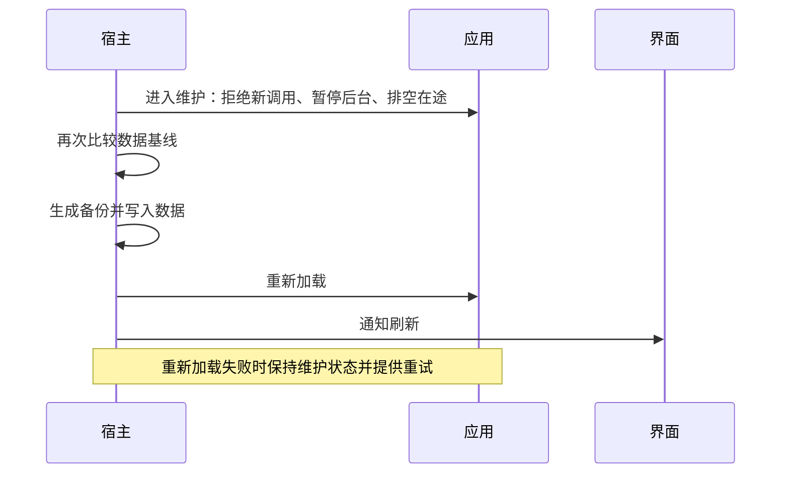

# 实现细节与验收

> 类型：现状与验收。目标规则见各设计专题；本页是“当前实现”的唯一归属。

本篇记录当前实现中与设计规则相关的具体事实：数据路径与恢复、生命周期实现、界面与会话实现、错误与历史、验收边界。规则本身以 [1-总体设计](1-总体设计.md) 至 [10-应用开发支持](10-应用开发支持.md) 为准；本篇只写实现侧的约束、入口和未覆盖项，不重复目标设计。

当前实现与目标设计的差异见[架构总览的第 4 节](../ARCHITECTURE.md#4-当前实现范围与未完成)，评审时应同时看对应设计篇和本篇。

## 1. 数据与一致性

### 1.1 数据归属

应用拥有业务数据，按需要使用文件、数据库或外部服务保存，并通过公开操作提供读取和更新能力。适合结构化键值数据的应用可复用统一存储，获得记录校验、写入排队和保存后的事件；它不改变应用对数据的所有权，应用停用时仍须释放自己打开的资源。

| 数据 | 由谁负责 | 用途与边界 |
|---|---|---|
| 业务数据 | 应用 | 保存、读取和恢复，并定义操作结果的业务含义 |
| 授权状态 | 平台权限管理 | 决定能力是否可用，与操作历史独立 |
| 当前运行状态 | 平台调用支持 | 表达正在执行的操作和进度，不代表业务数据已保存 |
| 操作历史 | 平台历史记录 | 查看和排错；可能不完整，不用于恢复数据或推断权限 |
| 界面状态 | 应用界面 | 管理选中项等交互状态；展示的业务数据以应用提供的内容为准 |

存储读取必须失败关闭：文件不存在按首次运行处理；文件存在但无法读取或解析时，保留原文件及其字节，读取结果不得被当作权威空文档，后续保存必须失败，不得用空文档、默认值或下一次保存覆盖看不懂的内容。应用自己的文件、平台存储和设置文档遵守同一规则；应用负责自己的保留策略，例如把软删除内容留在文档中并提供显式清理，而不是让回收站永久占用写入配额。

host-bridge 将宿主状态保存在 `$DSH_HOME/application-harness/`，与应用业务数据分开；文件清单、用途和读取失败时的行为统一维护在 [REFERENCE 的宿主状态文件表](../REFERENCE.md#宿主状态文件)，完整路径和归属以[部署声明](../../packages/bundle/app-harness/deployment.yml)为准。这些状态不放浏览器存储。

### 1.2 并发、幂等与变化通知

平台允许多个操作同时执行，不默认把整个应用的操作排队。应用负责业务数据的一致性，需要顺序执行的部分由应用按数据和操作控制；平台不保证调用先后等于完成先后，也不保证跨应用操作一起成功或回滚。AI 工具仍遵守 DeepSeek Harness 的调度规则，这不替代应用对界面、其他应用和后台工作的并发处理。

业务写入需要幂等时，目标应用将请求身份与业务结果关联保存，同一意图的重试重放原结果。传输请求 id 只关联调用与取消，不能代替业务参数中的 `requestId`。跨应用多步写入的补偿和恢复由应用设计，不承诺跨应用事务。

数据更新采用“应用通知变化，平台传递，界面按需重新读取”：应用保存数据或观察到外部变化后发出通知，平台传给已打开的界面，界面决定重新读取哪些内容。平台不从操作成败推断变化；第一阶段按应用发送通知，不要求字段级订阅，通知只表示需要刷新。

页面重新打开或连接恢复时主动读取当前数据，不依赖补齐通知或重放历史。界面先建立订阅再发起首次读取，以每次读取的先后为准丢弃过期结果；刷新不覆盖未保存的输入，编辑冲突由界面处理。应用依赖外部系统时，由应用负责观察或刷新并发出通知，平台不自动发现外部变化。刷新由状态更新完成，不通过重建页面实现。

### 1.3 统一存储与恢复

应用的文档型业务数据进入 `$DSH_HOME/application-harness/app-data.sqlite`；笔记附件字节由笔记应用管理在 `$DSH_HOME/application-harness/notes/attachments/`，平台整库备份不含附件字节。数据按应用 id 分区；同一家目录下切换工作区或 profile 不创建新的应用数据分区。

应用在 `mountApplication` 的工厂里拿到按声明 namespace 绑定的 [GatedStore](../../packages/application/store/src/gated.ts)，不接收数据库连接。接口包括文档、分页集合、迁移元数据和同步事务；文档用版本号检查并发写入，事务失败整体回滚。具体签名见源码。

存储检查在应用启动时绑定，每次使用都检查 `storage` 声明与授权；撤销后下一次使用即失败。事务回调收到的原始句柄只在事务期间有效，不得保留。

数据库打不开或完整性检查失败时，保留原文件、尽力复制损坏副本并拒绝启动，不用空库覆盖。`VACUUM INTO` 提供一致性备份，`exportAll`/`importAll` 提供可审查的 JSON 导出与恢复；这些是数据管理的基础，不替代应用自己的业务校验。

界面的导入和恢复以单个应用为单位：JSON 导入合并该应用的数据，SQLite 备份恢复精确替换其数据分区；其他应用不变。写入前生成整库备份。备份的来源限制和离线整库操作由应用存储实现和测试覆盖；数据路径见[部署声明](../../packages/bundle/app-harness/deployment.yml)。

预览生成带数据基线的短时计划；提交用计划 id 和 `requestId` 关联预览与重试。同一请求重复提交返回原结果，计划过期或基线变化时拒绝，不自动重放。具体协议见 [host-bridge](../../packages/application/host-bridge/src/index.ts)。

运行中应用的恢复流程：

1. 进入维护状态，拒绝新调用、暂停后台工作并排空在途调用。
2. 排空后再次比较数据基线，防止覆盖预览后完成的写入。
3. 生成备份并写入数据；写入失败时释放维护状态并报告错误。
4. 重新加载应用并通知界面。重新加载失败时保持维护状态，提供重试入口。

CLI 直接操作数据库，不执行上述应用维护流程。CLI 导入和整库替换必须在宿主停止后进行。

## 2. 生命周期与后台任务

应用生命周期接入 Cordis 插件机制，复用插件加载、卸载和异步资源清理。启用的应用随平台启动加载，停用或平台退出时停止。应用可提供启动和停止逻辑，读取数据、建立连接并释放资源；尚未准备好或已停用的应用不能按正常可调用应用处理。应用运行与页面是否打开无关：关闭页面不停止应用，也不影响 AI 或其他应用调用它。

应用可提供 `pause`/`resume` 钩子：宿主在导入维护窗口先暂停新后台工作、排空在途工作，释放后再恢复；未实现 pause 的应用仍有维护窗口内新起后台工作的残余。pause 与排空共用一个从入口开始计算的预算；钩子超时按 `maintenance-busy` 报告并清理持有态，钩子失败按 `maintenance-pause-failed` 报告，钩子本身不强杀。晚到的 pause 完成后，只有在没有更新持有态时补一次 resume，不会恢复旧维护窗口。

停用应用按以下顺序处理：

1. 停止接受新调用、结束待确认请求并停止触发新的后台任务。
2. 向在途操作发出取消请求，等待它们结束。
3. 清理资源；只有业务工作确实结束后才能移除注册项。

取消、等待和清理都算在同一次停用预算内；超时仍未结束、清理抛错或清理挂起时，明确报告停用未完成，不自动重启，也不把未结束的操作记成成功取消。应用行卸载时执行停止并只在业务工作确实结束后移除注册项；仍有工作运行时保留注册项，此时再加载同一应用会被拒绝。

行的加载与应用的启动是两个过程：启动完成前应用不可调用，卸载在启动进行中即触发取消和停止，不等待启动结果；晚到的启动结果不会重新开放应用。取消仍需要执行代码配合，平台不能安全地强行终止同进程中的任意应用代码。应用接入使用 [mountApplication](../../packages/application/runtime/src/index.ts)，统一处理上述生命周期。

后台工作归属于应用，遵守该应用的声明和权限，不能借后台执行绕过调用限制。优先复用适合的平台能力，但保留应用的生命周期。

平台 Jobs 的有主任务绑定存活的 Agent，无主任务不会自动归属应用；Schedule 是宿主级定时任务（after/at/every/daily/weekly/cron/rrule，带宿主管理界面），投递目标是已有或新建会话，但仍不能直接调用任意应用操作，因此不能当作应用操作调度器。

应用的后台长任务在目标上可镜像为平台 Jobs（会话头可见、可查询/取消、完成通知），业务状态仍以应用自己的持久记录为真源；当前只实现统一任务控制面，不含 Jobs 镜像。

### 2.1 后台任务

后台任务协议把应用自己的长任务变成统一控制面。应用通过 `OperationContext.startTask` / `AppContext.startTask` 创建任务，返回 `TaskHandle`；任务有 `running`/`cancelling`/`succeeded`/`failed`/`cancelled`/`interrupted` 状态、最新进度、取消信号、`externalId`（业务记录 id）和 `requestId`（幂等重放）。

任务取消和应用停用走同一个取消路径；stop 预算内未结束的任务如实保留，不伪造成已取消。

任务 id 同时作为最小 trace 锚点（`traceId`），与创建它的 operation `callId`、业务 `externalId` 串成链；后台任务的下游调用沿用创建它的应用调用链，从后台钩子启动时以所属应用为链起点；本期不建立完整 span 存储。

任务记录只是**控制面投影**，不是业务真源。统一任务的终态与业务记录一致：业务失败以该错误码投影为 `failed`，业务取消投影为 `cancelled`，报告发布之后的维护失败不把已完成的工作改判为失败。

宿主 bridge 把快照持久化为 `application-harness/tasks.jsonl`，只追加状态变化；启动时把仍为 `running`/`cancelling` 的任务标为 `interrupted`，不自动重放。bridge 暴露 `tasks()`、`cancelTask()` 和 `task` watch 帧，管理页的进行中队列和数据区的任务段从这条链路读取并支持取消。

信息收件箱刷新提供后台任务接入示例；跨重启自动 resume 和结构化 trace 查询不在当前实现范围。

应用操作只能通过 `startTask` 创建后台任务；start/stop 钩子里要等待的清理工作由钩子自己的 promise 承载，stop 预算同样约束它。不存在独立的低层后台工作注册入口。

## 3. 界面与会话

DeepSeek Harness 继续拥有布局服务、对话、工作区浏览、设置中心、主题和基础组件；Application Harness 在已有入口中组织应用导航和页面，不复制对话系统、设置中心或业务界面。应用负责自己的页面布局、展示和编辑交互；界面是可选的，无界面的应用仍可被 AI 和其他应用调用。

应用页面共用字号、间距、行高、密度、触控尺寸和圆角尺度，参数由[共享样式](../../packages/client/applications/src/client/tokens.module.css)定义。尺寸变量在文档根节点提供；颜色变量放在 `body`，保证侧栏和 portal 中的 Toast、平台弹框同样可用；管理页不是 portal，仍使用同一套变量。应用消费共享变量与控件，不各自定义一套尺度；[样式检查](../../scripts/verify-app-scale.mjs)约束字面量和明确标记的例外。

页面优先展示主内容：信息收件箱先动态后设置，未读取或未配置的来源收成简短说明，不占据多个空白统计区域。

### 3.1 页框、高度与首屏

外壳统一提供页边，应用页面不再加第二层内距。内容宽度分为满宽、居中内容和窄阅读区，应用使用共享宽度变量；具体数值与使用方式见[开发指南](../APPLICATION_DEVELOPMENT.md#5-开发应用界面)和共享样式。

全屏型页面在注册时声明 `contentLayout: 'fill'`（笔记、待办、收件箱、Git 浏览），由外壳把真实剩余高度交给页面根（`flex: 1 1 auto` + `min-height: 0`）；主页是 `flow` 文档流页面，由外壳提供滚动容器。页面里需要整页滚动的页签自带滚动容器。**禁止用 `100vh - 常数` 估算页面高度**：常数把平台头、应用头、页签和内距写死在一起，任何一行变高都会失准。

外壳固定两层：唯一应用品牌顶栏 `AppHeader` + 共享 `TabBar` 页签/工具行，高度由共享样式规定。页面自己的搜索与主按钮放在页签行的工具槽里，管理类动作可以留在同一行，但不得再加一条常驻工具行；筛选、批量操作这类展开态工具用浮层或抽屉，覆盖内容而不推挤。首屏预算：900 高窗口第一条数据 ≤200px，844 高的窄屏 ≤260px；当前没有自动度量脚本，按浏览器人工核对。

页面内的详情/抽屉锚定页面区而不是视口：面板使用共享宽度并限制在页面范围内，因此不覆盖页签与页面动作；≤720 铺满页面区并保留返回。形态按内容决定：笔记、待办与 Git 用浮层。锚定与容器测量的实现方式见开发指南。

本仓保留平台侧栏，不替换其 occupant。浏览区仍是平台 `WorkspaceBrowser` 的尺寸容器：平台侧栏的滚动区域 `.scrollRegion` 声明 `container-type: size`（`.regionArea` 本身不是尺寸容器），平台用 `100cqh` 把展开的工作区/会话区限制在侧栏视口内并让内部列表滚动。缺失尺寸容器会让展开后的列表按视口高度增长、滚动条不出现。

断点只保留 720 与 1040 两档。内容布局按**内容宽度**判断（`@container`），因为侧栏展开/收起会让内容宽度变化而视口不变：笔记、收件箱和主页的页面根都是查询容器。Toast、平台弹框这类 portal 到 body 的表面按视口判断（`@media`）；管理页沿用应用区的内容宽度判断 1040 分栏。应用区外壳用 `ResizeObserver` 测量内容宽度：小于 720 为紧凑（页头动作收成图标），小于 1040 时管理页用列表/详情分页和应用区会话覆盖面板，达到 1040 才并排。

### 3.2 导航与布局

应用区通过平台侧栏的**可加面板**接入：applications 包向 `sidebar.panellist` 注册一行（id 即 `main` 的 key），并向 keyed `main` 注册应用区；平台 `ui-sidebar` 继续声明并渲染品牌、面板清单、工作区、设置等子插槽。侧栏行的行为不变：点击选择应用区面板并进入上次应用；平台行在已选中时幂等。应用区不再消费入口请求，也不再切换导航。

平台侧栏首次启动按平台默认展开（约 280px），用户展开或收起后按浏览器记住选择；窄屏断点不记录偏好，跨断点只恢复平台自己的桌面状态。

应用区是单列：共享 48px 页头的左段依次为上下文返回、固定页签、应用（完整列表与 pin）、状态控件和当前应用管理；页面上下文在 dock 内容顶部以条目标示并可移除，不在页头重复应用页签。

dock 打开时右段是 Session tab 条，分隔线落在 dock 左边缘，没有独立的第二条 dock 标题行。

dock 关闭时页头最右端是“打开右侧边栏”按钮：32px ghost、panel-left 镜像图标；不注册快捷键。

打开后按钮消失，由 tab 条末端的 panel 控件收起。没有导航列、抽屉或页头切换器。上下文返回只有一个：有跨应用来源时指向来源应用，管理页指回当前应用，否则离开应用区回对话；跨应用来源不再增加第二个 chevron。页签列出已固定的应用（图标、名称、状态点，当前高亮），当前应用未固定时作为末尾临时页签；页签是 roving tablist，方向键、Home/End 移动并选择，当前页签滚入可见。

页签只列已固定应用，顺序来自 `pinned`（未保存时全部有页面的应用固定，并按宿主顺序）；当前应用未固定时作为末尾临时页签，切走后消失。

固定页签整块可拖动排序（插入线指示落点），右键菜单提供固定/取消固定与前移/后移；页头“应用”面板列出全部页面应用（当前打勾、状态点、pin 开关），pin/取消固定后面板不关闭，底部固定应用管理。放不下时横向滚动；进入区域由平台行选择面板完成，区域恢复上次应用。
dock 的 Session tab 条在共享页头右段：应用区会话、当前应用的开发会话、其他应用开发会话的折叠入口和普通会话；tab 是 DSH 式 chip（类型图标、平台 Session 标题、关闭都在 chip 内），Session 运行/待确认/最近一轮失败/未读以图标右下角小点显示。

`+` 紧跟 tab 条，可新建或重新打开已关闭的 Session。

dock 的宽度、展开、当前 tab、折叠组和普通 tab 列表都存在界面偏好里。

宽度按 DSH 右栏的几何：首次打开取应用区内容宽度的 45%，最小 300，最大 `min(70% 内容宽度, 内容宽度-400)`；整条左边缘是 8px 拖拽层，pointer capture + rAF，拖动时暂停过渡，不画可见把手。

宽屏打开/收起用 DSH 的 slow/ease 过渡宽度和内容，收起延迟到过渡结束再释放 Session；窄屏（<1040）整宽面板、隐藏应用 header、左侧返回，不做自动全屏。

tab 右键菜单提供在会话区打开、关闭、关闭其他、关闭右侧；页面上下文在 dock 内容顶部单独控制；tab 条末端是在会话区打开、收起（panel-left 镜像），没有全屏；收起按钮使用 `data-sidebar-right-toggle`，全屏不再作为应用 dock 的 presentation。区域小于 720 为紧凑：页签横向滚动、右侧动作收成图标；720–1039 保持常规动作；管理页和 dock 在 1040 以下用分页/覆盖，1040 以上才分栏，不另做应用抽屉。

应用列表尚未加载时显示加载状态，不能把尚未知道当成没有应用；当前应用暂时不可用时显示实际状态、原因和可执行的恢复入口，保留已有输入，不静默切换后丢弃工作。

应用排序的界面入口是页签直接拖动和页签右键的前移/后移；顺序写入 `pinned`，新应用排在末尾，已移除的应用不占位；搜索和排序仍归应用管理。

跨应用导航通过一次性 route intent 表达，外壳维护有界的内存返回栈（上限见源码常量）。打开记录、返回和直接切换应用都先执行当前页的离开保护；直接切换通过后清空返回栈。当前不提供 URL、浏览器后退或深链契约。

### 3.3 会话与页面上下文

应用区会话可读取当前页面上下文：宿主为每次页面报告分配 `pageId` 与新的 `snapshotId`，`pages` 工具只对标记过的应用/开发会话返回 `pageId`、`snapshotId`、view、`draftId`、label、当前记录/选择、过滤、可见范围和未保存标记，不读取 DOM、业务正文或草稿正文。普通会话没有页面上下文。

`pages.open` 通过 watch 流把命令发给 owner client，由 owner client 执行当前应用内导航并回执；`pages.act` 的 `navigate/set-filters/select` 走同一命令通道。成功回执是 `{ accepted: true }`，不直接返回页面上下文；调用者随后用 `pages.read` 读取当前页，`pages.read` 的 `pageId` 可选，传入时校验当前页面并拒绝旧 id。
`pages`/`pageActions` 声明已延期，平台不按声明校验 view/action；页面通过 `pageActions.onAction` 注册 controller，未注册的动作或页面拒绝时返回拒绝。

页面上下文可携带 `view/selection/filters/visibleRange/dirty/draftId`；客户端上报完整字段，宿主逐项校验形状；笔记编辑器已接入共享、读取、更新与撤销。草稿只有用户显式共享后才可通过 `drafts` 工具读取，并可随时撤销：宿主只保存 `pageId/draftId/字段范围/Session`，读取经 owner client 的页面 controller 返回 revision 与共享范围内的 values；未共享、跨页或越界字段被拒绝。

`drafts.update` 同样经页面 controller，校验共享字段与 revision；页面返回 conflict 时映射为 `platform.draft-conflict`。owner Session、可见页面和 pageId/snapshot 仍逐次校验；页面实例变化或关闭时，等待中的页面/草稿命令立即失败，旧客户端回执被忽略。

应用区会话不是普通会话的第二呈现，而是应用区自己的会话。首次点“右侧对话”时，应用区显式创建或选择一个应用区工作区（默认建议 `~/dsh-workspaces/app-conversation/<profile>`；宿主只创建这条建议路径，用户选择其他绝对路径时目录必须已存在，不静默创建、不切换当前活动工作区）。用户确认后，客户端经平台工作区服务注册该目录，在该工作区用标准 preset 创建一个默认会话，并把 `workspaceId + sessionId` 记在应用区的界面偏好里。

宿主另外把该会话身份持久化在 `$DSH_HOME/application-harness/app-conversation.json`，启动时自动标记它，保证从应用区还是平台会话列表进入都获得同一套应用工具。

之后右栏通过标准 `SessionProvider` 绑定这个会话，复用平台的会话内容、composer、流式与确认，不复制输入框；应用页始终是主面板，区域达到 1040 时右栏并排，小于 1040 时覆盖。

没有配置应用区工作区时，右栏显示显式设置入口，不能借用普通会话。清除过期目标时同时删除宿主记录并解除标记。

应用区支持多个会话：应用区会话共用一个专属工作区，宿主保存权威 Session 列表，浏览器另存 UI 映射；开发会话按应用保存列表，每个会话显式选择源码路径。

dock 每个 Session 一个 tab，关闭只从 dock 移除视图、不删除 Session；应用区会话和开发会话可 `在会话区打开`，DSH 会话 header 只对这两类 Session 提供 `在应用区打开`；普通会话不提供该 header 动作，仍可从 dock 的 `+` 打开。同一 Session 不复制。页面上下文只绑定当前显示的会话；开发会话只在应用页可见且绑定应用匹配时带页面上下文，普通会话没有。页面关闭时宿主发出通知，客户端清理页面级临时状态。

会话委托已是宿主持久对象：应用创建 pending，用户在发送对话框检查应用指令（只读）、选择/新建应用区会话并写补充；平台用 `followup` 发送一条 user 消息，注入可信委托上下文与 `delegation_report` 工具；回报只存最新结果，状态变化发应用 change，应用读取后由用户确认写回业务。平台不保存回报历史，不做自动重发/续跑；重启把 active/needs-person 标为 interrupted。

所有会话挂载同一个 `applications` 工具。普通会话的范围按轮次绑定：`agent/pre-step` 只从真实用户消息解析 `@app`，同一轮的多次、多应用调用共享该范围；下一轮没有新的 `@` 时范围清空，历史引用和模型自述不能恢复。应用区会话在创建时由宿主标记；标记只扩大“可查看/可读取”的应用范围，不绕过作者默认、用户策略、确认或业务校验。应用区会话仍使用普通的工作区与会话记录，不另造身份；两边各自保留历史、草稿和审批，切换由人完成。

页面上下文只代表当前可见的应用页面，离开应用区后不得由隐藏或已卸载的页面覆盖当前引用；未保存输入不自动共享。普通会话不接收页面上下文，只通过本轮真实的 `@` 使用应用；应用区会话把当前应用页面作为默认可见、可移除的上下文，发送时由宿主验证。上下文帮助表达意图，不代表授权，也不保证对象仍处于原状态；执行时仍检查目标和权限。页面服务、固定动作与草稿共享已接入；页面实例变化、快照过期或页面关闭时，等待中的命令立即失败，旧回执被忽略。

页面引用携带记录身份、选中项、视图、可见范围、过滤条件与是否存在草稿，不复制正文或草稿。笔记与待办通过 `contextState`/记录事实提供宿主核对所需事实；信息收件箱等其他记录族尚未接入宿主记录源，页面引用不能仅凭上报就视为已核验，接入需要补宿主解析。

### 3.4 开发会话（后端）

开发会话通过 `development.json` 绑定一个应用。工具面只允许查看/调用该绑定应用；调用身份携带 `developmentApp`，运行时对该应用的**写操作强制逐次确认**，不受作者默认、用户覆盖或既有授权影响；读操作仍按普通策略。开发会话没有确认渠道时写调用返回 `confirmation-unavailable`。应用区已提供开发会话创建入口：用户选择源码工作区后创建标准 Session 并在宿主登记，成功后可在主区域打开。`new-app` 脚手架、跨应用声明展示和 `validate:app` 隔离验证实例已提供；候选版本晋升到日常部署尚未实现，当前只有显式部署动作。

### 3.5 应用管理与启用状态

对外运行的 `runtime` 状态固定为 `stopped/starting/ready/stopping`；详细 `status` 只用于诊断与兼容。`activation` 是用户设置，与运行时状态、健康和权限分开：停用只停止应用并保留数据、授权和订阅记录，启用重新启动同一注册；已停用的应用仍出现在列表和概览页，但调用返回 `unavailable`。停用先走完整停止路径，停止未完成时如实显示；重新启用不能覆盖未结束的停止。启用/停用写入 `activation.json`，保存失败不能显示成功；部署组合仍决定哪些应用可被加载，第一版不提供运行时从任意目录安装或卸载。

应用的展示身份由注册方声明：本地化名称与一句话描述、平台图标与语义色调；未声明图标的注册使用框架的中性回退。页面可以通过注册时绑定的 `openManagement` 打开自己应用的权限页，不查 DOM，也不授予任何权限。

应用管理是应用区级页面，不是弹框。页头是上下文返回（回当前应用）、标题“应用管理 / 当前应用”和壳级状态控件，不显示应用页签、应用面板、应用区会话和当前应用菜单；宽屏左侧常驻应用列表、右侧详情，窄屏列表/详情分页。列表包含全部已注册应用（含没有界面的应用），支持搜索（名称、描述、id）、排序（默认/名称/状态）、“使用中”标记，以及有数量或读取失败时的待确认、进行中固定条目。列表底部另有固定的「应用网络代理」一项：它不属于任何应用，不参与搜索与排序，详情页只渲染该设置的表单（不出现应用四区）；设置字段是 `app-http` 行的即时 `proxy` 配置，保存后下一次应用请求生效。

点开固定条目在右侧显示跨应用队列，队列读取失败时保留重试。详情按状态与版本、权限与连接、数据与记录、应用设置四个区域组织；没有注册 Settings 的应用不出现设置区。

状态区展示身份、版本、运行/启用/健康、原因、激活、声明和折叠的开发者信息；页头的状态行提供显式健康检查。权限区展示平台能力、进程命令清单、对外调用策略、模型/限额和委托；跨应用声明在状态区的开发者折叠段展示；数据区展示数据路径/容量/集合、导入导出、备份恢复和清理、后台任务与调用历史；导入、恢复、清理共用同一个 warning Modal：默认焦点在取消，Esc/遮罩取消，预览和结果留在数据区。通用调用表单只从状态区的开发者折叠入口打开，不充当默认业务页面。

管理其他应用不切换底下正在使用的业务页面：应用 frame 保持挂载但不可见，管理页关闭时恢复该页面，不重建。管理页 header 的上下文返回关闭管理并回到应用页签；窄屏 `Esc` 先从详情回列表、再回应用，宽屏直接回应用；离开应用区关闭管理。列表里的“打开应用”是显式切换当前应用并回到该应用页；管理其他应用不触发它。

详情按四区组织，不再使用「设置 / 权限 / 概览 / 数据 / 后台任务 / 委托 / 调用历史 / 开发者」的旧页签：后台任务、调用历史在数据区，委托和模型/限额在权限区，开发者/调试在状态区的折叠段。权限区分该应用使用的平台能力、对外操作策略、模型/限额和委托；跨应用声明在开发者折叠段展示，不能把全局授权表直接呈现为当前应用的权限；历史默认展示以当前应用为目标的调用，调用方身份如实显示。待确认请求在管理页的固定条目中处理并有数量提示，可撤回等待，不占据正常业务页面；有效会话内的确认继续使用平台审批界面。

### 3.6 设置与草稿

应用设置由平台提供位置和公共控件，应用按需提供内容并负责读取、校验、保存和生效；设置通过应用自己的业务能力读写，沿用调用、权限和变化通知，不引入平台统一持有所有配置的存储或通用表单语言。

长期偏好进入设置，即时筛选、排序、当前目录等日常操作留在业务页面。

设置使用明确的保存动作：未修改时保存不可用，保存中阻止重复提交，成功只清除本次已提交且未再编辑的草稿，失败保留输入。切换页签或关闭后重新打开不静默丢弃未应用的输入，正在保存时关闭再打开不重复提交同一次写入。

写操作以一次意图为单位：未保存输入按应用草稿保存（同一套版本化记录），提交时记录快照与请求身份；内容相同的重试复用同一个请求 id，应用按 `requestId` 保存 receipt 并回放，平台只传递和校验请求 id，不提供通用去重；内容变化则视为新意图；成功只清除提交时捕获的版本。归档、恢复等没有草稿的点击型写操作不持久化请求 id。

保存动作在页面打开时可见，正文是唯一滚动区；校验按后端实际规则复述并定位字段。权限属于平台管理，设置页遇到缺少授权只说明原因并给出权限页入口。

同一个浏览器页面内，切换应用、打开管理或往返对话，保留各应用的草稿、选中项、筛选和滚动位置；恢复界面状态不能替代读取最新数据，也不能重放修改。

### 3.7 界面状态与滚动

滚动位置分两层：业务面外层滚动由框架按应用加视图记忆，应用内部滚动区用共享辅助按同样的键规则各自记忆；位置在滚动事件中记录（不在卸载时才记录），内容增长时重试，用户自己滚动即结束自动恢复，刷新后不承诺恢复。

管理页的滚动按左侧列表、待确认/进行中队列和每个应用的每个区域分别记忆；离开应用区关闭管理但保留位置。设置区的滚动归设置页自己。

界面状态按应用和工作区隔离，生命周期不依赖某次页面挂载；不保存服务、运行上下文、组件实例或订阅句柄，应用注销、工作区切换和客户端服务释放时清理关联资源。

### 3.8 错误、主题与可访问性

公共页面采用紧凑顶栏、清楚的分隔和可用的内容空间，不给整页或普通分区额外套浮动卡片；只在独立重复项、弹框和确实需要边框的工具上使用卡片。字体、颜色、图标、菜单、弹框和控件优先复用平台，主题随平台切换。

加载、无内容、未配置、应用不可用和连接中断是不同状态：首次必要读取失败时不能把“0 条 / 空列表”当作读取成功，已有数据和草稿在重读失败时保留并标明更新失败；错误在对应操作附近呈现，影响整页的连接状态用公共提示，不用失败页覆盖已有草稿。

权限拒绝按结果里的 `status`/`code` 判别，不解析英文文案：`capability-not-approved`（用户可授权）给当前应用权限页入口和一次只读重试（重新挂载页面、重跑读取，不重放失败的写操作）；`capability-undeclared`（应用没有声明，授权解决不了）只说明原因。一般拒绝、未开放、传输断线各自表达，未知错误用本地化概括并保留原始 code/message。耗时工作使用现有进度和取消能力，切换页面不停止宿主工作；普通读取不反复触发全局“任务进行中”提示。

提示与错误不得新增占据正常布局的行、推挤业务内容：壳级持续状态进入页头状态控件，页面读取失败用内容状态占位（成功后才显示空态），瞬时结果用 Toast，表单和局部操作错误留在操作附近；刻意展开的任务内容（导入预览、清理确认）不在此列。权限类失败按同因合并，权限动作只在页头状态控件，局部区域保留“尚未读取”的占位并指向它。状态面板位于页头之下、页面内容之上；平台弹框与 Toast 仍在它之上。

选择控件按语义分工：切换内容面板用 `tab`（`aria-selected`），互斥的呈现方式用 `radio`（`aria-checked`），独立开关用 `aria-pressed`；三者都提供方向键、Home/End 与单一 Tab 停靠点，焦点跟随选中项。

导航、菜单、页签、弹框支持键盘操作、焦点恢复和可访问名称，弹框内的快捷键不触发底层业务操作；平台侧栏抽屉、管理页和内容区各自约束尺寸与滚动，不出现文字遮挡、不可达控件或整页横向溢出。窄屏判断依据实际内容宽度，不能只看浏览器总宽度。

### 3.9 界面审查现状

以下为当前实现中已核实、与 §3.8 的界面规则或[页面交互](7-页面与人机交互.md#应用区入口与切换)的目标不一致的事实；规则本身不在这里重复。改动时先按所属规则补断言，再改实现。

| 方面 | 当前事实 | 证据 |
|---|---|---|
| 权限与失败呈现 | 壳级权限/错误从固定浮层改为页头状态控件（常驻中性状态点；有错误/警告时图标 + 数量；进行中只在展开面板里出现、不算警告；面板关闭不占布局）；笔记、收件箱、主页的首次读取失败改为轻量内容占位（权限动作只在页头，页面不重复），计数显示“尚未读取/—”；状态/健康原始 detail 收进状态面板的诊断折叠，页面不再显示“（部分功能降级）”。管理页数据/恢复/全局以及激活/模型/限制/委托错误和收件箱动作/来源/设置错误都改为本地化标题加诊断折叠；todo 页面已按同一模式对齐首次读取、权限占位和本地错误；Git 权限失败单独成类、原文进诊断；主页概览与活动按区记录失败，不再互相掩盖；收件箱和 Git 在返回/切换后恢复原记录与工作区状态；状态面板是 disclosure（按钮 aria-expanded/controls，面板 region），不是菜单 | [ApplicationsArea.tsx](../../packages/client/applications/src/client/ApplicationsArea.tsx) · [AppHeader.tsx](../../packages/client/applications/src/client/AppHeader.tsx) · [read-failure.tsx](../../packages/client/chrome/src/read-failure.tsx) · [local-failure.tsx](../../packages/client/chrome/src/local-failure.tsx) · [NotesView.tsx](../../apps/notes/view/src/client/NotesView.tsx) · [InboxView.tsx](../../apps/inbox/view/src/client/InboxView.tsx) · [HomeView.tsx](../../apps/home/view/src/client/HomeView.tsx) · [TodoView.tsx](../../apps/todo/view/src/client/TodoView.tsx) · [GitBrowserView.tsx](../../apps/git-browser/view/src/client/GitBrowserView.tsx) |
| 应用区 Session dock | dock 与 DSH 右侧栏同构：共享 48px 页头右段是 Session tab 条（分隔线在 dock 左边缘），内容列无独立标题行；应用区会话、当前应用开发会话、其他应用开发会话折叠入口、普通会话各一个 tab，带类型图标、Session 标题、关闭；`+` 新建/重开；宽度拖拽（整条左边缘、DSH 默认/范围）、在会话区打开、折叠/展开和 tab 状态持久化；dock 关闭时 32px 的“打开右侧边栏”按钮在页头右端，不注册快捷键；关闭文案为“从侧栏关闭”，实际只从侧栏移除视图，会话本身仍在；页面上下文条目在 dock 内容顶部，可移除或恢复；同一 Session 可在 DSH 会话区和应用区 dock 打开，不复制，不并排；不注册 DSH 原生右侧栏 tab | [ApplicationsDock.tsx](../../packages/client/applications/src/client/ApplicationsDock.tsx) · [ApplicationsArea.tsx](../../packages/client/applications/src/client/ApplicationsArea.tsx) · [dock.ts](../../packages/client/applications/src/client/dock.ts) |
| 管理界面 | 管理是四区应用区级页面：header 只有上下文返回、标题（带当前应用）和状态控件；宽屏列表常驻、窄屏分页；没有应用注册 Settings，设置区不出现；状态/健康原因把五个已知 `AppReason` 映射成中文标签，未知 code 显示“未知原因”，原始 code/detail 收在诊断折叠里；恢复、导入、清理共用同一个 warning Modal，默认焦点在取消，Esc/遮罩取消，预览和结果留在数据区；对外策略用应用给出的动作描述作标签、技术操作名和作者默认值进详情；普通就绪行只保留紧凑圆点并维持可访问名；列表行不再用 aria-label 覆盖整行（见可访问性） | [ManagementPage.tsx](../../packages/client/applications/src/client/ManagementPage.tsx) · [Lists.tsx](../../packages/client/applications/src/client/Lists.tsx) |
| 基础件与令牌 | 未定义的 CSS 类/变量和错误状态 token 已修（窄屏会话面板、调用表单输入、数据元信息、`--muted*`、警告 token）；未使用的 `--app-*` 令牌已删；页头/管理页/状态面板及页面动作补了 `:focus-visible`；壳层与应用页面的 hover 规则包进 `@media (hover: hover)`；D1 的导航/对象引用死样式已删，旧 conversation/dock 样式仍有残留待清理。按确认的边界保留行、页签、返回、原生 select 和文件选择等语义控件，动作控件走平台 `Button` | [ApplicationsArea.module.css](../../packages/client/applications/src/client/ApplicationsArea.module.css) · [ApplicationsLists.module.css](../../packages/client/applications/src/client/ApplicationsLists.module.css) · [tokens.module.css](../../packages/client/applications/src/client/tokens.module.css) |
| 客户端产物与样式 | 自建 client 预设仍按旧契约在 factory 执行期注入 `<style data-plugin-css>`，未产出平台 0.2.3 的 `meta.stylesheets`：首屏与正常卸载不受影响，但插件被停用/热替换后旧样式保留到页面刷新；类名已按 `<hash>_<local>` 生成 | [tsdown.client.ts](../../packages/client/tsdown.client.ts) |
| 可访问性 | 页签、管理页搜索、页头/管理页/状态面板的原生动作，以及笔记/收件箱/主页/待办页面的原生控件都有统一的 `:focus-visible` 环；管理列表行不再用 `aria-label` 覆盖整行，名称、描述和状态都进入可访问名；状态面板是带 `aria-expanded`/`aria-controls` 的 disclosure，面板本身是 labelled region；主页卡头/记录、会话短标签和对象引用的完整 ID 都提供了可区分的目标或标题；dock 会话 tab 的方向键切换、Home/End 与 Delete 关闭可用，tab 右键菜单仅支持鼠标打开。仍缺：2× 缩放和真实读屏需要人工核对 | [ApplicationsArea.module.css](../../packages/client/applications/src/client/ApplicationsArea.module.css) · [ManagementPage.tsx](../../packages/client/applications/src/client/ManagementPage.tsx) · [NotesView.module.css](../../apps/notes/view/src/client/NotesView.module.css) · [InboxView.module.css](../../apps/inbox/view/src/client/InboxView.module.css) · [object-reference/index.tsx](../../packages/client/object-reference/src/index.tsx) |

## 4. 结果、故障与可观测性

成功时向调用方返回结果；失败时明确报告原因，使人、AI 和其他应用都能识别。未进入操作的拒绝与执行后的失败应当能够区分。长时间操作按需提供进度和取消；取消是停止请求，不等于撤销已保存的数据或已发生的外部动作，业务补偿和恢复由应用负责。平台不自动重试业务操作，避免重复创建、发送或修改；应用或调用方可以按业务语义决定是否重试。

平台保留基本操作历史，回答谁调用了什么、开始和结束时间、结果状态及失败原因，不默认保存完整参数和返回内容。历史用于查看和排错，不承担业务状态恢复。历史允许不完整：记录失败应报告记录故障，但不阻止业务执行，也不把已成功的操作改判失败；没有历史记录不等于操作没有发生。

挂载 `app-bridge` 时，基本操作历史持久化为 `application-harness/history.jsonl`：每行一条记录，串行追加；按容量轮转并在启动时恢复有限窗口，轮转文件备份需一并处理；坏行跳过并报告，读/写失败按空历史或丢失处理，不影响业务调用。它只记录调用边，不记录应用内部业务事件；没有 `app-bridge` 的组合仍使用运行时内存窗口。

以上约定仅针对基本操作历史。DeepSeek Harness 的 AI 会话日志和审批记录继续遵守平台契约，可能记录工具参数与结果；记录写入失败仍可能阻止 AI 调用或使本轮会话失败。执行失败可能已经产生部分效果，进程退出或返回中断也可能使调用方无法确认最终结果；平台不据此推断业务已回滚，也不自动重试。

任务记录通过 `taskId` / `traceId` 与创建它的 `callId`、业务 `externalId` 关联，供定位调用和工作归属；不把任务快照或历史记录当成业务恢复依据。完整 span 存储与结构化 trace 查询不属于当前契约。

会话委托执行中的应用调用通过 `caller.sessionId` 与委托关联，不另设 `delegationId`；同一执行会话同一时间只有一个活跃委托。

## 5. 当前未完成与边界

以下差异以当前源码和测试为准，已发布版本见 GitHub Releases。每一行的锚点给出主要证据：测试表示该行行为有断言；只标源码入口的行表示尚无测试覆盖（如“未实现/无产生路径”），改动时先补断言再改这一行；版本号与某次验收的历史不写在这里。

| 能力 | 当前事实 | 锚点 | 目标篇 |
|---|---|---|---|
| 会话委托 | 宿主持久委托（pending/active/needs-person/ended）；用户显式发送到应用区会话，`delegation_report` 只存最新结果；应用读取 + change，用户确认后写回；重启 interrupted，无历史/自动重发；委托上下文只在执行开始时注入一次；应用侧记录入口受 `delegate` 能力门约束（未声明/未授权分别报 `app.capability-undeclared`/`app.capability-not-approved`）；平台只保证一个执行会话一个活跃委托，不按业务对象去重 | [delegations.spec.ts](../../packages/application/host-bridge/tests/delegations.spec.ts) · [delegation.client.spec.ts](../../packages/client/applications/tests/delegation.client.spec.ts) | [会话委托](9-会话委托.md) |
| 委托待回答的呈现 | 管理页显示最近回报的问题并随应用 change 重读；应用区没有聚合提示 | [ManagementPage.tsx](../../packages/client/applications/src/client/ManagementPage.tsx) · [TodoView.tsx](../../apps/todo/view/src/client/TodoView.tsx) | [会话委托](9-会话委托.md#打开执行) |
| 页面归属与关闭广播 | 宿主在页面替换或清空时广播 `page-closed`、失效等待中的命令并撤销共享；同一 Session 的多个客户端以最近上报者为页面归属，命令与回执按该 Peer 定向，不保存多份快照 | [shell.client.spec.ts](../../packages/client/applications/tests/shell.client.spec.ts) · [bridge.spec.ts](../../packages/application/host-bridge/tests/bridge.spec.ts) | [页面交互](7-页面与人机交互.md) · [会话接入](8-会话接入.md#并存与页面绑定) |
| 草稿 revision | 读取与更新校验 revision，冲突映射为 `platform.draft-conflict`；共享记录本身不保存 revision，且只在宿主内存中保存，不跨重启 | [bridge.spec.ts](../../packages/application/host-bridge/tests/bridge.spec.ts) | [页面交互](7-页面与人机交互.md) |
| 跨应用页面调用身份 | 页面 props 只提供绑定自身应用的 `call`；对象解析由宿主以 `human` 执行窄例外；跨应用页面调用被拒绝 | [shell.client.spec.ts](../../packages/client/applications/tests/shell.client.spec.ts) · [bridge.spec.ts](../../packages/application/host-bridge/tests/bridge.spec.ts) | [权限与调用](3-权限与调用.md) |
| 确认上下文 | 确认请求带调用方/能力/理由，以及有界、脱敏的 `preview.effect/args`；等待 5 分钟超时，调用取消中止；页面/客户端交互上下文尚未实现，页面关闭不会结束停放的确认，无 session 的 app caller 停在管理页外部确认表；页面绑定确认是已确认的延期项（A7）；用户取消折叠为 `rejected` | [confirmation.spec.ts](../../packages/application/host-bridge/tests/confirmation.spec.ts) · [bridge.spec.ts](../../packages/application/host-bridge/tests/bridge.spec.ts) | [权限与调用](3-权限与调用.md) |
| 协议表面 | `protocolVersion`、`pages.contextSchema`、`errors` 声明未实现；`pages`/`pageActions` 声明已延期；运行时的 `CallOutcome` 按 status 必填 result/error，宿主到浏览器的线上形状仍是可选字段；`unknown` 第五态当前没有产生路径 | [types.ts](../../packages/application/runtime/src/types.ts) · [host-bridge/types.ts](../../packages/application/host-bridge/src/types.ts) | [统一协议](2-统一JSON协议.md) |
| 对象引用解析 | 共享对象引用组件支持显式 `title`，或在 `title` 缺失且传入 `resolveObject` 时自动解析标题/摘要；引用不匹配或解析失败保留原引用并暴露错误，只有 `app.not-found`（对象已删除）显示不可用 | [object-reference.client.spec.tsx](../../packages/client/object-reference/tests/object-reference.client.spec.tsx) | [对象引用的解析与打开](6-应用互联.md#对象引用的解析与打开) |
| 页面服务返回形状 | `pages.open/act` 成功只返回 `{ accepted: true }`，上下文由后续 `pages.read` 提供；`read` 的 `pageId` 可选，传入时校验，旧页面返回 `pages/stale-snapshot` | [bridge.spec.ts](../../packages/application/host-bridge/tests/bridge.spec.ts) · [unified.spec.ts](../../packages/application/tool-bridge/tests/unified.spec.ts) | [页面与人机交互](7-页面与人机交互.md#页面服务与动作) |
| 模型用量展示 | 管理页显示调用/成功/失败/取消、总耗时、已知 token、缺失用量和最近一次模型/状态；两侧 token 都未知时显示“未提供”，不记为零 | [applications-panel.client.spec.tsx](../../packages/client/applications/tests/applications-panel.client.spec.tsx) | [平台能力](5-平台能力.md#平台统一模型接口) |
| 操作 effect 校验 | generation 2 的每个操作必须显式声明 `effect`；generation 1 仍缺省 `write`；注册时校验 | [contracts.spec.ts](../../packages/application/runtime/tests/contracts.spec.ts) | [统一协议](2-统一JSON协议.md) |
| 进程命令面 | 应用声明 `process` 数组；运行时 `ctx.process.run` 检查 `process` 能力与授权，记录 `op: process` + `command` 的历史；声明不是执行级白名单 | [process.spec.ts](../../packages/application/runtime/tests/process.spec.ts) | [平台能力](5-平台能力.md#存储与进程) |
| 进程限额 | 平台 subprocess 负责 spawn、终止、取消信号和 grace；超时与输出字节上限目前由应用适配器（Git runner）施加，平台不替应用统一选择或钳制这些限额；设计目标尚未实现 | [subprocess.spec.ts](../../apps/git-browser/host/tests/subprocess.spec.ts) | [平台能力](5-平台能力.md#存储与进程) |
| 生命周期与维护状态 | 维护期间 `ready + health=degraded`；健康检查声明入口已实现（start/恢复/用户检查，超时/异常降级，unhealthy 停止且不自动重启）；不伪造成 `starting + updating` | [health.spec.ts](../../packages/application/runtime/tests/health.spec.ts) | [应用结构与运行](4-应用结构与运行.md) |

### 5.1 生命周期现状

| 场景 | 实际状态 |
|---|---|
| 启动中 | `activation=enabled`、`runtime=starting`；启动完成 `ready` |
| 启动失败 | 运行期显示 `activation=disabled`、`runtime=stopped`、`reason=platform.start-failed`；不写入用户 `activation.json`，重启按用户设置重试 |
| 维护/更新 | 实际保持 `runtime=ready`、`health=degraded`、`reason=platform.updating`，不是目标文档的 `starting + updating` |
| 停止中 | `activation=enabled`、`runtime=stopping`；停止尝试结束后落 `disabled`（成功或超预算） |
| 停止预算耗尽/清理未完成 | `runtime=stopping`、`reason=platform.stop-incomplete`；不伪造成 `stopped`；无 pending 工作后可重试停止 |
| 健康检查失败（unhealthy） | `activation=enabled`、`runtime=stopped`、`reason=platform.health-failed`；晚到收尾仍保留该诊断；不自动重启 |

健康检查在启动完成、维护恢复和用户显式检查时执行，超时、抛错或非法结果按 `health=degraded` 记录；返回 `unhealthy` 时停止实例并保留 `reason=platform.health-failed`，`activation` 保持用户设置。`AppInfo.health` 只在 `runtime=ready` 时提供，非 ready 状态的诊断走 `reason/detail`。调用是否可执行以 runtime 状态为准，`health=degraded` 不自动阻断业务操作。

目标设计中的 `platform.unavailable` 生命周期原因当前没有设置路径，只有调用拒绝码 `platform.unavailable`。与 [4 的目标矩阵](4-应用结构与运行.md#生命周期与后台工作) 的另一处差异是停止态：目标写用户停用即 `disabled + stopping`，当前实现到停止尝试结束才落 `disabled`；停止运行中仍是 `enabled + stopping`，超预算后是 `disabled + stopping`。依赖 `activation` 的调用方不要按目标矩阵提前判断。

### 5.2 错误码

调用方只能按稳定 `error.code` 分支，不解析文案。完整错误码表、应用业务错误约定和当前没有产生路径的码见 [REFERENCE](../REFERENCE.md#错误码)。

## 6. 验收边界

实现需要通过真实应用验证以下行为，而不仅是接口可以调用：

- 人与 AI 使用同一应用时操作同一份数据、执行相同的业务规则，并按各自调用方式检查权限；用户撤销授权后，相关调用受限且不影响其他已授权能力。
- 未声明的平台能力直接拒绝，声明但未授权的使用不执行并报告需要授权；应用不能自行授权，授权变更保存失败不得报告为已保存。
- 应用 A 调用应用 B 时检查双方声明与用户授权，不借用人的身份或继承 B 的其他权限；跨应用集成只使用公开操作。
- 应用未提供页面上下文时，AI 仍可通过查询操作寻找目标或询问用户；页面上下文不共享未保存输入，也不视为授权。
- 卸载、停用和启动中卸载走同一条停止路径：超时或清理失败如实报告，不自动重启，未结束的操作不记成成功取消。
- 操作被取消或返回中断时，不把已经发生的效果当作已撤销，不自动重试。
- 基本操作历史无法写入时业务仍可执行并返回自己的结果；AI 确认不可用或审批记录写入失败时目标操作不执行。
- 重启后未完成的后台任务显示为已中断且不自动重放；已完成的数据和报告保留，草稿由应用自己的机制恢复。
- 界面在切换应用、管理、对话和刷新后保留应有的草稿与状态；首次读取失败不显示成“0 条 / 空列表”，权限拒绝有本地化的说明和恢复入口。
- 窄屏、深浅主题和键盘操作下内容与控件不遮挡，弹框可关闭并恢复焦点，后台页面快捷键不误触发。

需要单独验证的边界（单元测试和脚本检查不能证明这些链路可用）：

- **会话内审批**：让 AI 在真实会话中调用 confirm 操作，验证批准、拒绝和审批记录；仅验证文本返回不覆盖该路径。
- **非 owner Peer**：通过真实连接验证平台 `RemoteAccessService` 对方法与事件的访问控制。
- **真实外部链路**：公网限流、代理故障、macOS/Windows 的进程与文件系统差异、屏幕阅读器审计，以及大规模索引压力，都不由替身测试代替。

每次验证的命令、范围和未覆盖项在对话或提交说明中报告；本文件不保存某次验收的历史结论。
