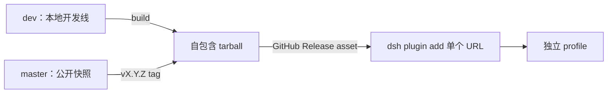

# 开发、安装与发布（交付设计）

> 类型：目标设计。当前实现与差异见 [11 §5](11-实现与验收.md#5-当前未完成与边界)；可执行命令见 [操作手册](../DEVELOPMENT.md)。

## 1. 目标与不变量

- 单一事实源：包名、`dsh.appRow`、bundle patch、`deployment.yml` 和版本只有一份。
- 开发态用 `link:`，发布态用预构建 tarball；不为两种形态维护两套 manifest。
- 日常开发与发布构建都使用安装的 npm 平台线（`node scripts/deps.mjs` 安装的版本），没有源码 checkout 作为第二条线。
- 日常 profile 和插件 profile 分离，不互相覆盖依赖或业务数据。
- 发布物是**单个自包含 bundle tarball**，通过 GitHub Release asset 分发；用户不需要 npm 账号，也不需要配置 scope registry。
- 非官方项目，包和发布物不使用 `@deepseek-ai` scope。

## 2. 坐标与包集合

| 项目 | 约定 |
|---|---|
| 仓库 | `matrix1001/dsh-application-harness` |
| 发布入口 | GitHub Releases asset |
| scope | `@matrix1001` |
| 可发布包 | 所有非 private 的 `@matrix1001/dsh-application-harness*` 包同版本发布，版本一致性由 `verify-version-sync` 核对 |
| 发布 bundle | `@matrix1001/dsh-application-harness` 自包含 tarball |
| 平台线 | `engines.dsh: 0.2.3-alpha.2`（精确版本，只支持最新发布版本） |

bundle 的运行时 row 包在发布 tarball 中作为 bundle 的嵌套依赖存在；平台包保持 peer，由宿主 DSH 提供。`packages/typert/protocol` 跟平台线、不参与插件版本同步。

发布 tarball 的 package.json 同时包含：

- 自有包在 `dependencies` 中的精确版本（集合以 bundle 的 `dependencies` 为准）；
- 同名 `bundleDependencies` 列表；
- bundle 自带的 `node_modules/@matrix1001/*`；
- `dsh.bundle.patch`、`cordis.patch.yml`、`deployment.yml` 和 `lib/`。

这使 `dsh plugin add <tarball-url>` 只安装一个包，不再解析外部 `@matrix1001` registry。

## 3. 开发线

### 3.1 平台线

唯一输入是 npm 已发布的 `@deepseek-ai/dsh` 版本，记在 `deployment.yml` 的 `platform.declaredLine`：

- 所有 `@deepseek-ai/dsh*` pin 与每个部署包的 `engines.dsh` 都是这个精确版本。
- 客户端测试读取 `.platform-src/` 夹具：由 `scripts/sync-platform-fixture.mjs` 从 `node_modules` 生成，不是第二条源码线。
- Typert generator、类型、客户端 bundle 与运行时全部来自同一次 `node scripts/deps.mjs` 安装。
- `pnpm run build` 就是发布构建：本机、CI 与 tarball 没有第二条构建线。

只支持最新发布版本；新版本发布后用 `node scripts/platform-line.mjs --set <version>` 升级，按编译和测试的失败适配。

### 3.2 Profile 与 DSH_HOME

| 用途 | profile | DSH_HOME | 包来源 |
|---|---|---|---|
| 日常开发 | `application-harness` | 默认 `~/.dsh` | 本仓 `link:` |
| 插件 / dogfood | `application-harness` | 独立，例如 `~/.dsh-application-harness-release` | 自包含 tarball |
| 自动安装验收 | `plugin-e2e` | `tmp/plugin-e2e/home` | 自包含 tarball |

`plugin-e2e` 是 `test-plugin-local` 的一次性内部 profile，不属于用户配置。插件安装与日常开发都使用 `application-harness` profile，靠独立 DSH_HOME 隔离；不要在同一家目录混用，避免插件安装读写日常业务数据、凭据和会话。操作步骤见[开发、安装与发布操作 §1](../DEVELOPMENT.md#1-环境隔离)。

### 3.3 开发态行为

日常开发通过 `scripts/dev.mjs` 做初始构建、串行重建 host/client，并按需启动 web。host 和 client 的两遍 tsdown 共用 `lib/`，不能并行；client 改动后手动刷新，host 改动默认重启。`--hmr` 是实验性 host HMR overlay，linked 包的依赖级联可能重置连接或应用面板，不作为稳定契约，也不提供应用内重载按钮或 route。

依赖或包结构变化不自动修复；需要重新 `setup` 时明确提示，不带着半坏 profile 启动。`pnpm dev --watch-only` 只构建和监听，不启动 server。

### 3.4 平台升级适配

1. `node scripts/platform-line.mjs --set <version>`：校验该版本（含所有直接依赖的平台包）已发布，改写 pins/engines/mirror 清单，安装依赖，并从安装产物刷新 Typert 协议壳。
2. `pnpm run typecheck` / `pnpm run test`：失败就是适配清单。
3. `pnpm run release:check` 收口。
4. npm 未齐时命令拒绝；`--allow-unpublished` 只用于明确跟踪未发布版本，发布前必须回到已发布版本。

## 4. 安装线

用户安装的是预构建 tarball，通过 `dsh plugin add <release-asset-url>` 进入独立 profile；不运行作者构建脚本，不需要 scope registry、`npm config set` 或 `allowBuilds`。

- 插件 profile 必须与日常开发 profile 分离；同名 `application-harness` 也必须在不同 `DSH_HOME` 下使用。
- 安装后应核对嵌套自有包清单、bundle 版本和 locale；profile 的 `dsh.profile.bundles` 应包含 bundle。
- 更新是换新版本 asset URL 后重新 `dsh plugin add`；旧版本由 GitHub Releases 保留。
- 卸载默认保留业务数据；具体命令见[开发、安装与发布操作 §3](../DEVELOPMENT.md#3-安装-release)。
- 插件执行本机代码，只安装可信 Release；第一版不提供自动版本列表或自动更新 UI。

### 4.1 自包含 tarball 的原因

- 自有包不能各自要求用户配置私有 registry；一个 tarball 把闭包收进 bundle。
- pnpm 默认的 `blockExoticSubdeps` 会拒绝远程 URL 作为子依赖；自包含 tarball 不依赖 exotic subdependency。
- DSH 原生支持 HTTP tarball spec，GitHub Release asset 可直接安装。
- 版本保留由 GitHub Releases 负责，不再维护 `registry` 分支或合并 metadata。

## 5. 发布线



### 5.1 版本

- 独立 SemVer release train；所有可发布包同版本。
- 首个公开版本 `0.1.0`。
- `dev` 发版后进入下一个 `-dev.N`；dev 版本只用于本地，不发布。
- 正式版本才打 `vX.Y.Z` tag；tag 必须与 bundle 版本一致。

### 5.2 发布物

发布脚本生成一个自包含 tarball：

1. `pnpm run build`：与 CI、本机同一条 npm 平台线。
2. `node scripts/build-plugin-tarball.mjs` 用 `pnpm pack` 打包运行时自有包。
3. 把包解包到 bundle 的 `node_modules/@matrix1001/*`，把 bundle 的 `dependencies` 改为精确版本并写入 `bundleDependencies`。
4. 在临时 pack 根目录用 `npm pack` 打包 bundle（pnpm 不支持 `bundleDependencies`，且会跟随父级 `node_modules` 生成不安全的 `../` 条目）。
5. 校验 tarball 含全部嵌套包、bundle patch、locale 元数据、LICENSE、无 `workspace:`，并生成独立的同名 `.sha256` 校验文件。

资产命名：

```text
matrix1001-dsh-application-harness-<version>.tgz
matrix1001-dsh-application-harness-<version>.tgz.sha256
```

### 5.3 公开快照与推送

- `dev` 保留完整开发历史，不推送；`master` 是公开快照线，每个正式版本一个 snapshot commit。
- 公开快照从正式版本的 release tree 生成，不能用当前 `-dev.N` 的 tree；首次快照无父 commit，之后以 `master` 为父，公开历史只追加。
- tag `vX.Y.Z` 必须指向公开快照，且 bundle 版本一致；不能打在 dev commit 上。
- 公开快照必须排除 `.claude/`、`.agents/`、`.codex/`、`tmp/`、`dist/` 等本地或生成内容。
- 已发布历史和 tag 不重写；只有尚未发布的快照修正可用 `--force-with-lease`，且先说明原因并取得用户确认。
- 任何 push/tag 前报告 ref、commit、tag、版本和验证结果，等待用户明确确认；先推 `master` 并等 CI 全绿，再单独确认推 tag。完整步骤和检查清单见[开发、安装与发布操作 §4](../DEVELOPMENT.md#4-发布)。

### 5.4 CI

| 触发 | 检查 |
|---|---|
| PR | `.github/workflows/ci.yml`：`typecheck:release`、`check:docs`、`test:coverage`、`build`、release tarball 结构检查、`test:scripts`、publint、声明/部署门禁，以及隔离实例的 browser smoke |
| Tag | `.github/workflows/release.yml`：`release:check`（同一 npm 平台线）、`test-plugin-local`、自包含 tarball 与 `.sha256`、GitHub Release assets |

PR 构建并检查 tarball 结构，但不安装；完整 tarball 安装验收由 tag Release workflow 执行。发布仍需手动定版本、生成公开快照并打 `vX.Y.Z` tag。

### 5.5 发现性

- 仓库添加 GitHub topic `dsh-plugin`。
- Release notes 给出安装命令。
- 不进入 npm 插件市场（本方案不使用 npm registry）；如需市场索引，后续单独提供索引条目或 npm 发布。

## 6. 验证与安全

日常与发布命令见[开发、安装与发布操作](../DEVELOPMENT.md)；验收边界和当前未完成项见[实现细节与验收](11-实现与验收.md)。

安全边界：

- 发布 tarball 只包含本仓自有包和平台 peer 声明。
- 平台包仍由宿主提供；不把平台实现打进 bundle。
- 不新增本地 dev route；第一版无额外网络入口。
- 插件运行在本机进程内，不提供第三方代码沙箱承诺。

## 7. 状态与操作入口

本文只保留交付设计和边界。当前实现、未完成项和验收矩阵见[实现细节与验收](11-实现与验收.md)；开发、安装、发布和推送命令见[开发、安装与发布操作](../DEVELOPMENT.md)；修改仓库的规则见 [AGENTS](../../AGENTS.md)。
