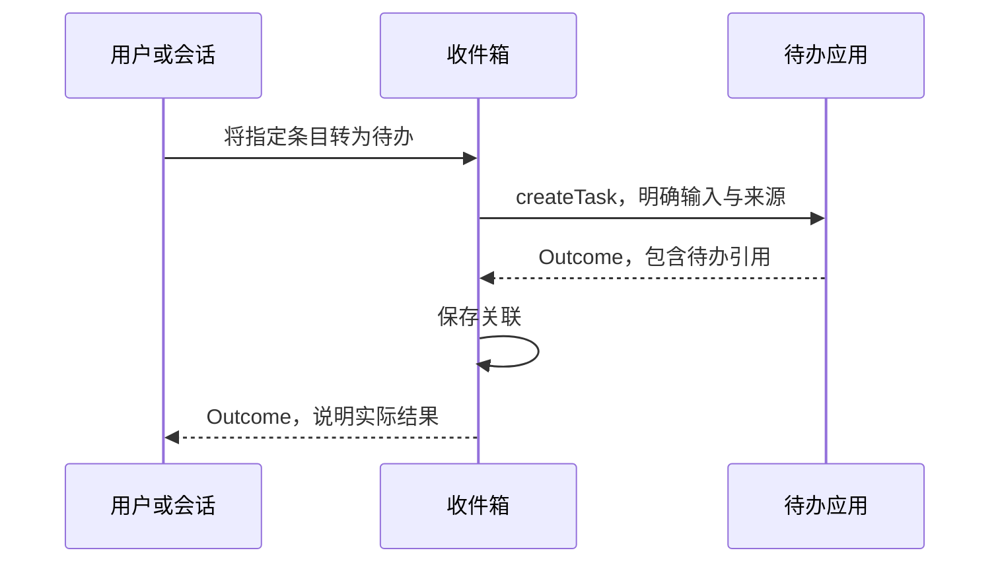

# 应用互联

> 类型：目标设计。当前实现与差异见 [11 §5](11-实现与验收.md#5-当前未完成与边界)。

[总体设计](1-总体设计.md) · [用词约定](1-总体设计.md#用词约定) · 共同的请求、结果、Schema 和 `ObjectRef` 见[统一 JSON 协议](2-统一JSON协议.md)，身份与执行策略见[权限与调用](3-权限与调用.md)。

## 两种交互模式

| 模式 | 用途 | 示例 |
|---|---|---|
| 调用 | 请求目标应用完成明确操作并返回结果 | 收件箱请求待办应用创建待办 |
| 状态刷新提示 | 关注指定应用的变化，收到提示后按需读取当前状态并刷新展示 | 待办关注收件箱新条目变化并刷新角标 |

对象引用是两种模式共用的业务关联方式，用于定位对象、保存关联、展示摘要和打开原对象。应用不要求共同数据库，也不要求统一所有业务字段。

第一版通知只用于状态同步和界面或缓存刷新，不触发业务写入、会话委托或其他外部副作用。调用与订阅均明确指定协作对象，目标缺失只影响对应协作功能，不自动替换目标。

## 明确目标与局部不可用

应用的 `calls` 声明由 `AppId | { app, ops }` 项组成；字符串形式表示目标应用当前全部已开放操作，`{ app, ops }` 明确限定操作。实际调用明确指定目标和输入；新应用应优先使用显式 `ops`，避免无意的宽授权。

声明约束调用方的协作范围，不另授予逐调用方权限；目标操作按该调用方类别的作者默认与用户覆盖执行。注册表支持列举与查询声明，**不按能力匹配、推荐替代提供方或自动选择目标**。

调用时检查目标当前声明；操作不存在返回 `platform.unknown-operation`，输入不匹配返回 `platform.invalid-input`，不自动转换字段、猜测修复接口或选择替代目标。

普通会话的 `@` 只约束会话直接调用的目标。会话在本轮 `@A` 后触发 A→B 时，A 按已声明的协作目标发起应用间调用，不要求再次 `@B`；平台把 A 作为 B 的直接可信来源，独立检查 B 的开放声明、`peers` 作者默认与用户覆盖、用户访问范围、输入和确认。B 按正常的 A→B 调用处理，不需要解析会话的 `@` 或整条上游链；模型或会话直接调用 B 时仍须本轮 `@B`。

运行时携带可信调用链，拒绝循环调用、超过固定深度或重复链路的调用；应用不能通过业务参数改写调用链。每一跳保留来源应用和目标应用的最小关联信息，平台记录完整链路用于安全、审计和诊断，但不把链路变成业务权限。

同步调用及其启动的后台任务沿用来源链，后台任务另有 `taskId`；确认的交互上下文只随同步调用传递，后台任务及其下游调用使用 `none`，需要确认时返回 `rejected` + `platform.confirmation-unavailable`。订阅通知独立触发，不继承发布方原调用链，订阅方后续调用生成新的链路。平台拒绝循环或超限时返回明确平台错误，不自动换目标或重试。

跨应用写入不享有平台通用幂等或恰好一次保证。发起方需要重复安全时，应使用目标应用声明的业务请求号或状态版本，并在结果未知后先查询；目标应用负责重复提交与冲突语义。平台不把调用链或 `callId` 当作业务去重依据。

跨应用调用遇到目标操作的确认策略时，沿用[权限与调用](3-权限与调用.md)的逐操作确认。交互上下文为 `session` 或 `page` 时，平台可在有限等待时间内暂停调用等待决定；订阅、后台任务和其他 `none` 触发不能代替用户确认，直接返回 `rejected` + `platform.confirmation-unavailable`，不自动批准、排队或重试。

需要后台完成的流程只能调用该调用方类别按作者默认或用户覆盖为“无需确认”的操作；操作声明为 `open` 或用户已将其策略调整为“无需确认”时均可执行。需要确认的流程由应用保存待处理项，等待用户通过正常入口重新发起。

交互丢失、当前轮次结束、状态或策略变化会使待确认调用失效；确认只覆盖当前目标操作，拒绝或取消后将结果返回发起应用，后续调用由发起应用按结果处理。

跨应用更新目标对象时，目标应用的 `expectedVersion` 和业务冲突规则仍然生效；平台不为一组跨应用调用提供事务、自动合并或回滚。发起方应处理目标返回的冲突或未知结果，并通过后续明确操作完成补偿。

协作声明不是调用方的强制加载或启动依赖。平台提供按声明检查的可用状态；界面展示状态，执行时再次检查。

| 目标状态 | 行为 |
|---|---|
| 未加载、停用、离线 | 对应协作功能不可用，主应用和其他协作功能继续使用 |
| 未开放或被用户禁止 | 明确说明策略原因，不绕过检查 |
| 加载完成、策略变化或重新可用 | 重新检查后恢复功能入口，无需重启调用方，不补做原请求 |

例如，收件箱依赖待办应用的 `createTask` 操作；待办应用新增独立操作时，收件箱继续可用。待办应用删除 `createTask` 或改变其输入含义后，收件箱只有“转为待办”不可用，收集、阅读和收藏继续工作；重新读取当前声明并更新调用后才能恢复。应用前端可以提前提示，但不能把一次可用检查当作后续调用许可。

## 流程归属

确定的协作流程由提供该业务功能的应用组织，用户和会话复用同一操作。目标应用负责自己的校验与状态，发起方负责输入准备、流程进展和交互。



如果待办已创建但关联保存失败，收件箱报告已知部分效果和待办引用，不能自动再创建待办。平台不提供跨应用事务或自动补偿；有独立业务含义的复杂流程可以成为应用，仍遵守相同协议与规则。

目标发现缺少输入时返回结构化错误，由发起方补充或向用户提问；目标不直接控制其他应用的弹窗或会话。平台的权限确认继续在调用边界执行。

所有调用和多步流程都不自动重试。手动再次操作需要明确决定是继续原意图还是创建新意图；需要防止重复业务效果时，应用显式声明 `input.requestId` 等业务去重字段并保存对应结果，同一意图复用原值，新意图使用新值，不把 `callId` 当作去重键。平台不引入统一重试或去重服务。

## 对象引用的解析与打开

对象类型和解析操作来自应用的 `objectTypes` 声明，不另建对象注册中心。对象链接可以在用户明确点击后请求平台切换到目标应用，并携带原始 `ObjectRef`；平台只负责切换和传递引用，目标应用自行解析对象并检查权限。页面服务仍只绑定当前应用和 owner session 的可见页面，不跨应用提供，也不创建隐藏页面实例。应用按对象 `type` 声明 `resolveOperation`；解析操作是正常的只读操作，输入为 `{ id }`，成功结果为：

| 字段 | 规则 |
|---|---|
| `ref` | 完整 `ObjectRef`，必须与请求的应用、类型和 ID 对应 |
| `title` | 必填展示名 |
| `summary` | 可选简短摘要 |

平台通用引用组件按类型声明调用解析操作；调用权限仍按真实调用方检查。被其他应用解析时，调用方须声明该解析操作，并按目标操作的当前策略执行或请求确认，不新增绕过用户设置的通道。

引用组件只有在需要展示标题、摘要或打开对象时才发起解析；仅展示已有 `ObjectRef` 不自动读取业务正文。解析需要确认时，组件等待当前交互的确认结果；交互不可用就返回对应确认错误，不降级为无确认读取，也不把解析结果扩展为完整对象。

属于当前应用的对象可由应用在自己的页面内打开，路由和页面选择由应用解释。其他应用的 `ObjectRef` 只有在用户明确点击后才能触发切换；平台不替用户读取正文、不授予目标应用权限，也不允许后台任务或模型自动导航。标题与摘要只是展示信息，具体业务属性通过明确操作读取。对象删除、无权、所属应用不可用或页面不存在时，保留原 `ObjectRef`，通过 `Outcome.error.details` 返回稳定的结构化原因；不把缓存摘要当作当前事实，也不按名称猜测替代对象。

业务导出中的外部 `ObjectRef` 只表示关联，不携带目标对象正文、权限或凭据。导入后目标应用不可用、对象不存在或调用方无权时，关联保持不可解析并提示原因；应用可以提供明确的重新关联操作，但平台不按名称猜测匹配、不自动创建替代对象。

例如，待办读取关联笔记需要调用笔记应用的业务查询，不能解析标题来推断内容。

## 业务变化通知

发布应用定义并发布已经发生的业务变化提示，不指定接收方执行什么动作；订阅应用可以在自己的后端按提示读取当前状态，刷新展示或非业务缓存。通知是刷新提示，不是应用后端保持一致性的同步协议；需要可靠同步时由订阅应用提供自己的当前状态查询、差异查询或修复操作。平台负责声明校验、授权、投递和订阅生命周期，不提供事件动作编排器，也不允许通知自动触发业务写入、会话委托或其他外部副作用。订阅随应用后端运行与有效授权生效，不依赖业务页面是否打开。

例如，收件箱保存新条目后发布变化提示，平台交给已获准订阅的待办后端；待办按权限读取当前收件箱状态，再刷新角标。收件箱不需要知道待办如何展示，也不等待待办处理完成才认定自身保存成功。

发布方声明 `events`：每种事件包括 `type`、`description`，以及 `subscription: open/closed`（默认关闭）；说明须让用户理解事件用途和变化范围。订阅方以 `{ appId, type }` 明确声明来源，并在启动时登记订阅意图；发布方尚未注册时意图保留，发布方注册后自动绑定；发布方已注册但事件尚未开放时同样保留意图，不阻断订阅方启动，事件开放后投递自动恢复。平台按投递时的声明与有效授权决定是否交付；被动通知不使用 `confirm` 或进行逐条确认。

用户按声明允许或禁止订阅，授权与撤销规则集中见[订阅授权](3-权限与调用.md#业务变化订阅授权)。本节定义事件声明与投递行为。

```json
{
  "kind": "app-event",
  "appId": "todo",
  "type": "task.changed",
  "eventId": "event-001",
  "occurredAt": "2026-11-07T10:00:00Z",
  "refs": [{ "appId": "todo", "type": "task", "id": "123" }]
}
```

`kind/appId/type/eventId/occurredAt` 必填，`refs` 是可选 `ObjectRef` 数组；`refs` 只能指向发布方自己的对象，平台拒绝其他应用的引用。`eventId` 与 `occurredAt` 由平台生成，分别用于关联本次通知和表示变化发生时间；`appId` 由发布入口绑定，不能由应用冒充。公共形状只在本篇定义，具体业务类型由应用定义。

通知只携带识别变化所需的最小信息：事件类型、发生时间、受影响对象引用和平台生成的 `eventId`，不附带正文、字段值、变化前后内容或变化摘要。`eventId` 只用于诊断和应用去重，不代表全局顺序。订阅方收到后按事件类型和 `refs` 决定是否读取当前状态；删除事件由事件类型和对象引用表达，不要求读取已删除对象。

通知说明某类变化已发生，不携带业务正文，也不保证对象仍存在或仍是当前状态；需要当前业务数据时按权限通过应用操作读取。订阅方可根据事件类型和对象引用忽略无关通知、标记待刷新或发起读取，不要求每条通知都追加一次调用。

发布者不需要知道有哪些订阅方。订阅应用可在收到提示后自动读取当前状态并刷新展示或缓存，处理失败不自动重试；通知不能自动触发业务写入、会话委托或其他外部副作用。任何业务写入仍须由明确业务流程发起，并检查订阅应用自身的声明、权限和确认策略。通知只含类型、时间和对象引用，不包含业务正文；读取对象内容仍按应用操作权限检查。

采用实时、尽力投递，不保存通知历史、不补发、不自动重试，不保证顺序、唯一投递或每次变化都被处理。订阅应用启动或连接恢复后先建立订阅，再按权限读取当前状态；后续通知按需触发新的读取。持续变化可合并刷新，旧读取结果不能覆盖更新的读取结果。需要维护后端缓存或关联状态的应用，应在启动、重连和必要的修复入口调用自己的当前状态查询、差异查询或修复操作；应用可依据业务版本或对象时间戳丢弃过期结果，不能把通知直接当作最终业务事实。

界面刷新可以使用应用级通用变化提示；第一版不建设用于持续业务协作的事件动作链。页面重新打开时读取当前状态，不依赖收到全部提示。平台不提供通知游标或可靠消费确认。状态刷新提示不承担可靠业务队列职责；例如“每完成一个任务就发一封邮件”，不能依靠实时提示保证执行。要求逐次可靠处理的业务由拥有它的应用持久化必要记录，通过明确的查询或领取操作处理，并自行管理处理进度和重复效果。

## 验收约束

- 缺少一个协作应用不会阻止主应用启动；恢复后只恢复功能，不重放历史请求。
- 页面与会话触发同一业务流程时，复用相同的应用操作实现与业务校验，各自遵循调用权限。
- 跨应用调用按目标操作逐次确认；有用户交互时展示直接来源和目标操作，无交互时明确返回 `rejected` + `platform.confirmation-unavailable`，不自动批准或重试。
- 解析引用、订阅事件不能越过调用方权限；通知丢失后读取当前状态仍能恢复正确展示。
- 用户点击对象引用时可以切换到目标应用并携带 `ObjectRef`；切换不授予权限、不读取正文，后台任务和模型不能自动触发。
- 通知只含事件类型、时间和对象引用，不含业务正文或字段值；删除事件用事件类型和对象引用表达，不要求读取已删除对象。
- 通知只允许触发当前状态读取、展示或缓存刷新，不能自动写入业务数据、发起会话委托或产生其他外部副作用。
- 关闭页面不停止应用后端的有效订阅；发布方的业务成功不依赖订阅方处理成功，实时通知不被当作逐次可靠执行的保障。
- 部分成功、对象删除与声明变化有明确结果，不自动更换目标或重复执行。