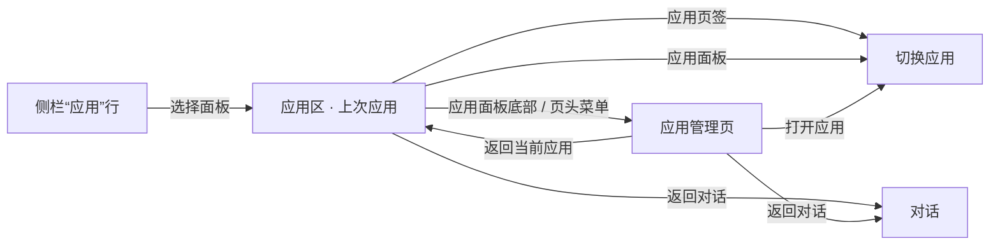

# 页面与人机交互

> 类型：目标设计。当前实现与差异见 [11 §5](11-实现与验收.md#5-当前未完成与边界)。
[总体设计](1-总体设计.md) · [用词约定](1-总体设计.md#用词约定) · 本篇定义用户如何通过界面与会话连续完成工作。所有公共值、`ObjectRef`、Schema 与 `Outcome` 复用[统一 JSON 协议](2-统一JSON协议.md)。

## 两种正式入口

界面适合浏览、编辑、比较和精确操作；会话适合表达目标、多步工作与跨应用协作。两者使用同一套业务能力和数据，可以在同一项工作中衔接。

用户可以在页面选中资料交给应用区会话，也可以从会话里的对象引用回到应用继续编辑。开发会话通过当前页面上下文观察页面，不接收应用准备的交接材料。普通会话不接收页面上下文，只通过用户本轮真实的 `@` 与应用交互。页面不要求每项操作都经过会话；应用自主提供的总结等模型功能按[平台模型能力](5-平台能力.md#平台统一模型接口)处理。

页面或会话展示已有 `ObjectRef` 时不自动读取业务正文；需要标题、摘要或打开对象才调用应用声明的解析操作，并沿用该操作的身份、范围和确认策略。解析等待确认或失败时保留引用本身，不用缓存正文或猜测替代对象。

页面服务的会话入口只在页面实例已打开、且它的 owner session 是侧栏绑定的应用区会话或开发会话时提供；页面服务只操作该可见页面，不跨应用、不提供隐藏页面。普通会话不提供 `pages.open/read/act`，也不接收页面上下文。应用可以在用户明确点击对象链接后请求平台切换到目标应用并携带 `ObjectRef`，目标应用再自行解析和检查权限；这不授予跨应用权限，也不允许后台或模型自动导航。用户直接操作当前应用页面是独立的页面交互，不把页面状态变成普通会话授权。

普通会话输入框提供受限的 `@` 应用候选：只展示应用基本信息和状态，用户选择后写入草稿引用；发送前不建立授权，删除引用或放弃草稿不产生范围。候选、规范化引用和发送后的范围规则见[权限与调用](3-权限与调用.md#普通会话输入)。

## 平台前端与应用前端

| 平台前端提供 | 应用前端提供 |
|---|---|
| 应用列表、导航、可用状态、应用管理 | 业务页面、业务设置、筛选和具体编辑交互 |
| 共享布局尺度、主题、控件与可访问性基础 | 业务内容组织与状态解释 |
| 会话入口、上下文桥接、对象引用展示和打开 | 哪些页面状态、动作与草稿可接入 |
| 对外操作设置、平台能力授权、调用历史、后台任务与数据管理入口 | 数据含义、业务恢复与导入导出规则 |

应用首次打开或首次启用前，平台前端展示简要摘要：应用身份和来源、对外开放的写操作及默认确认方式、声明的平台能力、状态刷新订阅和数据位置。启用/停用只改变 `activation`，不自动授权能力、订阅或凭据。应用管理是应用区级页面，页头只有一个上下文返回（回当前应用）、标题“应用管理 / 当前应用”和壳级状态控件；宽屏左侧常驻应用列表（搜索、排序、当前应用标记、待确认/进行中固定条目），右侧是所选应用的四区详情，窄屏列表页与详情页互相切换。

管理页不显示应用页签、应用面板、应用区会话和当前应用菜单；在列表里换应用只换管理对象，不切换底下正在工作的应用；header 的上下文返回是回到应用页的动作，详情里的“打开应用”是显式切到该应用页。

应用管理提供“状态与版本”“权限与连接”“数据与记录”“应用设置”四个区域，包含启用、停用、更新和卸载；更新展示新增或变化的能力、操作和订阅，具体授权仍在权限与连接中完成。卸载默认保留应用数据和设置，重新安装后是否关联旧内容由用户明确选择。第一版应用随部署组合加载；管理界面中的安装/卸载指把应用加入或移出当前组合，不提供运行时从任意目录或 URL 安装。

### 状态与版本

这里显示 `activation`、`runtime`、`health`、`reason`、当前版本，提供启用、停用、更新和卸载。更新先展示候选版本的变化摘要，用户确认后才应用；更新期间为 `starting` + `reason=platform.updating`，启动、更新和停止中的原因按 `reason` 显示；`health=degraded` 显示受影响功能；应用自行执行迁移时，失败原因反映到 `stopped` + `reason=platform.start-failed`。卸载不自动清理数据、凭据、授权或平台记录。

### 权限与连接

这里集中管理应用的对外操作策略、平台能力授权、状态刷新订阅和直接模型选择。

对外操作显示用途、读写性质、按调用方类别的默认值和当前设置，规则见[权限与调用](3-权限与调用.md#设置入口与验收)；平台能力与状态刷新订阅显示声明、用途、当前授权和可用状态，缺少授权时显示原因和设置入口，补充授权不自动重跑原操作，规则见[平台能力长期授权](3-权限与调用.md#平台能力长期授权)和[订阅授权](3-权限与调用.md#业务变化订阅授权)；进程能力另显示声明的可执行文件和命令清单；新增能力和订阅默认未授权。

进程能力显示应用声明的可执行文件、命令名称和用途，并提供必要的调用摘要；凭据只显示名称、用途和“未设置／已设置”，不显示值，平台凭据只显示配置状态；直接模型设置提供“跟随默认／指定模型”、后台调用开关和简单并发／次数上限，并显示选择来源，不改变会话交接所用模型。

### 数据与记录

这里展示数据位置、备份说明以及应用支持的业务导入导出，规则见[应用数据管理](4-应用结构与运行.md#数据与工作区)。恢复只替换业务数据，不恢复权限、订阅或会话身份；操作前说明停用、排空、当前数据备份和失败保护；清理应用数据和平台运行记录分别确认，卸载本身不触发清理。调用历史、诊断日志、后台任务和已发送会话消息按用户与应用权限展示；业务对象已删除时明确显示不可解析状态，不显示缓存正文或猜测替代对象；平台不提供跨应用审计全文搜索，也不能从运行记录恢复业务数据。

### 应用设置

应用业务设置由应用声明字段、提供页面、校验并保存；平台只提供入口和路由，不为所有应用生成通用表单。应用设置不能授予权限、改变应用身份或替代凭据，敏感值必须使用凭据能力。设置变更对后续调用生效，运行中的任务继续使用已固定的配置；需要重启或迁移时由应用明确报告，不由平台自动重启。

普通会话界面提供当前执行轮次应用范围的查看与取消入口；取消时说明后续访问立即拒绝，已开始的调用不回滚，已建立的应用后台任务按自身生命周期继续处理。本轮结束后范围自动失效，后续使用需重新 `@`。此处只管理本轮临时范围，不改变应用的对外操作策略，规则见[权限与调用](3-权限与调用.md#统一入口与可访问范围)。

所有已注册应用都可在应用列表找到；没有页面的应用打开信息与管理入口，并按允许的调用方式使用。平台不根据 JSON Schema 自动生成完整业务界面。

应用前端按需加载，页面打开与后端启停分离；界面同时显示启用状态和运行状态，例如“已启用 · 启动中”“已停用 · 已停止”。缺少可选条件时显示 `health=degraded` 及受影响功能；`runtime` 为 `starting/stopping/stopped` 时按 `reason` 显示原因。页面不自行猜测是否可调用，统一读取平台状态；生命周期规则见[应用运行](4-应用结构与运行.md#生命周期与后台工作)。

### 应用区入口与切换

平台侧栏的“应用”行行为不变：点击选择应用区面板，并进入上次使用的应用；它不打开菜单。应用区是单列：页头依次是上下文返回、固定页签、应用（完整列表与 pin）、状态控件和全局动作，没有独立的导航列或页头切换器。页签是应用切换的常驻入口，当前页签同时表示应用身份；应用页面的标题与工具行留在页面内，页头不重复它们。

页签只列已固定应用，顺序来自用户保存的固定列表（未保存时全部有页面的应用固定并按宿主顺序），显示图标、名称和状态点，当前应用高亮；未固定的当前应用以末尾临时页签出现。点击页签直接切换，切换会清空跨应用记录历史。页签放不下时横向滚动，当前页签始终滚入可见。
页签整块可拖动排序，插入位置有 2px 指示线；页签右键菜单提供固定/取消固定、前移一位/后移一位（两端禁用）。
页签之外的“应用”面板列出全部页面应用（图标、名称、状态点、当前标记和 pin 开关），底部固定“应用管理”；面板有最大高度，超出时只有应用列表滚动。
点行切换应用并关闭面板；pin 开关只改固定状态、面板保持打开；再次点击、点击外部或 `Esc` 关闭且不导航，`Esc` 焦点回到触发器。面板列表尚未加载时沿用加载状态。

返回是页头最左的单一上下文动作，任何宽度下都在：有跨应用来源回来源应用/记录，管理页回当前应用，否则离开应用区回对话。页签是固定列表，拖动排序、右键固定/取消固定和前移/后移；“应用”面板列出全部页面应用并负责 pin/取消固定。

按 720/1040 两档响应：区域小于 720 为紧凑，页签横向滚动、右侧全局动作收成图标；720–1039 保持常规动作。平台侧栏自己的抽屉、收起与展开行为不受影响。菜单不做搜索、筛选和排序，这些入口放在应用管理。应用页面占主内容区。区域达到 1040 时右侧 Session dock 并排，小于 1040 时覆盖。

dock 的 Session tab 条在共享 48px 页头的右段、分隔线落在 dock 左边缘，没有独立的第二条标题行。应用区会话、当前应用的开发会话和普通会话各占一个 tab，其他应用的开发会话收在折叠入口里，带类型图标和平台 Session 标题；应用区会话和开发会话有当前页面上下文，普通会话没有。同一 Session 可以在 DSH 会话区和应用区 dock 打开，状态共享、切换使用，不同屏并列；不复制 Session。dock 关闭时页头右端保留“打开右侧边栏”按钮，不注册快捷键；打开后由 tab 条末端收起。

dock 的宽度按 DSH 右栏的规则拖动：首次打开取应用区内容宽度的 45%，最小 300，最大 `min(70%, 内容宽度-400)`；拖拽命中整条 dock 左边缘，不画可见把手。tab 条是 DSH 式 chip：图标、标题、关闭都在 chip 内，`+` 紧跟 tab 条；Session 运行/待确认/最近一轮失败/未读只在 tab 图标角标出。

tab 条末端是在会话区打开和收起，没有“全屏”；在会话区打开把当前 tab 的 Session 放到主会话区。宽屏打开/收起时 dock 宽度和内容滑动；窄屏（<1040）改为整宽面板并隐藏应用 header，左侧返回；不做 DSH 的自动全屏。右栏 header 的“在应用区打开”只对应用区会话和开发会话出现，普通会话不显示，仍可从 dock 的 `+` 打开。管理界面不切换底下正在工作的应用。

应用管理从应用面板底部进入列表，从页头 `•••` 进入当前应用详情；管理页用上下文返回、标题和状态控件的模式页头，不沿用应用页签。

列表常驻：搜索按名称、描述和 id 过滤，排序支持默认、名称、状态；当前应用标“使用中”；待确认、进行中作为有数量或读取失败时的固定条目，点开在右侧显示队列；管理其他应用不改变当前应用、不重建底下页面。列表底部另有固定的「应用网络代理」一项：它不属于任何应用，不参与搜索与排序，点开显示应用区自己的出网设置页（单一表单，不带应用四区），配置归属见[应用网络出口](5-平台能力.md#应用网络出口)。

详情按状态与版本、权限与连接、数据与记录、应用设置四区组织；设置区只在应用声明 Settings 时出现；旧概览页的开发者/调试入口收进状态区的折叠段。管理页按实际内容宽度响应，窄屏列表和详情分页，详情里的“返回列表”回列表，header 的上下文返回回当前应用，`Esc` 维持先列表后应用的层级；宽屏 `Esc` 直接返回应用。列表、队列和每个应用的每个区域分别记忆滚动位置；离开应用区仍关闭管理。



壳级状态集中在应用区页头的状态控件，控件常驻：没有需要处理的问题时是中性状态点，点开说明当前正常；有错误或警告（连接断开、壳级错误、应用不可用、激活异常、权限拒绝、降级）时变成警告图标加数量，点开显示原因、动作和诊断。进行中属于信息而不是问题：它只出现在展开的面板里，不把锚点画成警告，也不计入数量。面板关闭时不覆盖工具条。

状态控件是 disclosure（按钮 `aria-expanded`/`aria-controls`，面板是 labelled region），不是菜单，也不为此拆成二级弹框；面板在无状态下说明“当前没有需要处理的问题”。首次运行的授权摘要卡是显式例外，它自己承载允许/管理动作。页面内容只表达读取中、成功后的空、尚未读取和不可用：读取失败不显示成空列表或“0 条”，权限动作不在页面里重复，页面可以保留本地读取重试和诊断；页面不新增常驻提示行，也不在页面顶部重复“部分功能降级”这类壳级状态。局部操作失败留在操作附近，瞬时结果用 Toast。

沿用共享字号、颜色、间距、内容宽度与控件。断点只有 720 和 1040 两档：720 以下为紧凑，1040 及以上才允许分栏；页面按自己的内容宽度响应，不按浏览器窗口；只有 portal 到 body 的弹框和 Toast 按视口判断。界面按实际内容宽度响应，键盘可达、焦点可恢复，控件有可访问名称。加载、空数据、未配置、无权限和连接失败分别呈现；失败不能清空已读内容或草稿。

## 页面上下文

页面主动报告结构化状态，平台校验并标记来源。每个打开的页面实例由平台分配 `pageId`，并绑定一个 owner session——侧栏当前绑定的应用区会话或开发会话；`appId` 必须与该页面实例所属应用一致；`view` 由应用自己的页面路由解释，平台不按 `pages` 声明校验（声明延期）；提供 `record` 时，记录的 `appId` 必须与当前应用一致。

页面打开但没有侧栏会话时，页面实例没有 owner session；页面可以继续显示，但不提供页面服务，也不把上下文附加到任何会话。上报的应用与页面实例所属应用不一致时不接受为当前页面，并返回结构化错误。会话无需先解析 DOM 就能理解当前对象、选择和视图，但 JSON 不能证明实际布局与渲染正常。

```json
{
  "kind": "page-context",
  "pageId": "page-17",
  "snapshotId": "snapshot-42",
  "appId": "todo",
  "view": "list",
  "selection": [{ "appId": "todo", "type": "task", "id": "123" }],
  "filters": { "status": "open" },
  "hasUnsavedChanges": false
}
```

| 字段 | 规则 |
|---|---|
| `kind` | 固定 `page-context` |
| `pageId` | 平台分配的页面实例 ID，绑定当前客户端与 owner session；页面重挂载后失效 |
| `snapshotId` | 平台为一次报告生成的快照 ID，不是业务数据版本 |
| `appId`、`view` | 所属应用与稳定视图名；应用归属由注册绑定 |
| `record`、`selection` | 可选单个 `ObjectRef`、引用数组；空选择与未提供选择不同 |
| `filters`、`visibleRange` | 可选视图状态，当前按固定形状校验；`pages.contextSchema` 声明延期 |
| `hasUnsavedChanges` | 可选布尔值；未提供不能理解为无草稿 |

只有 owner session 能收到该页面的上下文和页面服务；其他会话即使知道 `pageId` 也不能访问。页面关闭、应用切换或会话解绑后，旧 `pageId` 和快照失效，不能继续上报为当前页。

`kind`、`pageId`、`snapshotId`、`appId`、`view` 必填，其他按需提供。页面不复制整个列表、业务对象或前端状态树；会话按引用通过对外开放的应用操作读取业务数据。筛选条件不代表所有符合条件的对象已显示或已选中。

应用区会话或开发会话发送消息时附加明确页面的快照，“这些”指向当时的选择。随后改变选择不能改写原消息；会话要最新状态时显式读取。附加页面只提供上下文，按所属会话的既有范围处理应用操作；普通会话不附加页面快照，也不能通过页面获得应用范围。页面关闭或应用移除后不能继续上报为当前页，历史快照只能解释历史消息。绑定规则见[会话接入](8-会话接入.md)。

## 页面服务与动作

页面服务是宿主经现有客户端连接向页面 controller 发起的浏览器交互面，不是应用后端的应用操作；全部返回 `Outcome`。每个打开的页面实例由平台分配 `pageId` 并绑定一个 owner session；只有 owner session 能访问该页面的上下文与页面服务，不能凭 `pageId` 跨客户端或跨应用访问，也不存在隐藏页面实例。应用前端注册页面 controller；平台只调用已注册的 controller，未注册、页面已关闭或导航离开时返回 `platform.page-unavailable`。

应用前端通过平台绑定的应用操作、页面服务和应用设置接口通信，只提交业务输入；不能直接访问数据库、凭据、宿主文件、其他应用 DOM 或共享内部状态总线。页面返回的数据按应用 Schema 和用户权限裁剪，平台内部错误、凭据原值和完整调用链不进入页面响应。

页面服务不提供平台文件上传或下载；应用自有文件由应用数据区或外部存储管理，浏览器不把本机路径交给应用，也不把临时 URL 当作业务引用。

调用经明确绑定的客户端通道执行，不能凭知道 `pageId` 访问其他窗口。没有可用客户端或页面时报告不可用，不替用户挑选另一个窗口。

| 方法 | 输入 | 成功的 `result` | 规则 |
|---|---|---|---|
| `pages.read` | `{ pageId? }` | 当前页面上下文 | 只读取 owner session 的可见页面；传入 `pageId` 时校验当前页，旧 id 返回 `pages/stale-snapshot` |
| `pages.open` | `{ view?, record? }` | `{ accepted: true }` | 只导航 owner session 的当前应用可见页面，不跨应用；随后用 `pages.read` 取页面上下文 |
| `pages.act` | `{ pageId, snapshotId, action, input }` | `{ accepted: true }` | 必须匹配当前可见页面和最新快照；只允许固定动作，只改 UI；随后用 `pages.read` 取上下文 |

`pages.open` 的 `view` 和可选 `record` 由当前应用绑定补齐，不能指定其他应用；`view` 由应用自己的页面路由解释，平台不再按 `pages` 声明校验。带 `record` 时，记录的 `appId` 必须与当前应用一致；应用负责判断对象是否存在、选择页面并解释路由，平台不要求对象类型与页面建立额外映射。

对象已删除、应用不可用或页面不存在时保留 `record` 的 `ObjectRef` 并返回结构化原因，不改打开到其他对象或页面。无 `record` 时，`view`（如提供）由本应用页面路由解释；省略时由应用选择默认页面，没有页面时返回不可用。导航导致页面实例重挂载时，平台分配新的 `pageId`，旧 `pageId` 及其快照立即失效；页面保持同一实例时返回同一 `pageId` 和新快照。

页面动作固定为 `navigate`（`view`、可选 `record`）、`set-filters`（`filters`）和 `select`（`selection`）。页面声明与逐视图固定动作清单延期；`navigate.view` 由应用自己的页面路由解释，带 `record` 时对象必须属于当前应用。输入不符合固定结构、页面不可用或快照已失效时返回 `rejected`，由调用者重新读取并决定，不把动作静默转到另一个页面。

页面服务只在 owner session 的当前用户交互中提供；后台任务、订阅通知、普通会话和其他应用不能调用。`pages.open/act` 改变的是用户可见页面，不能由后台或订阅触发；跨应用导航仍只能由用户点击对象链接触发，页面服务不跨应用。

页面服务使用稳定错误码：`platform.page-unavailable`（页面/客户端不可用）、`platform.stale-snapshot`（快照过期）、`platform.action-not-allowed`（动作结构不符合固定形状或页面 controller 拒绝），以及草稿相关错误；页面动作已经改变 UI 后无法完成时才用 `failed`，其余拒绝不执行动作。

动作只改变打开位置、视图、筛选和选择；创建、修改、删除等持久业务行为继续按调用方权限执行应用操作。页面动作本身不写入业务数据，不适用操作确认；如果页面动作需要业务写入，必须由应用调用自己的应用操作并遵守统一策略。页面上下文和可用动作不构成业务授权。开发验证可使用真实浏览器操作检查交互，日常业务调用优先使用明确动作与应用操作。

## 草稿与保存

默认上下文只说明有无未保存内容，不自动传草稿正文。草稿正文只在用户显式共享后进入会话：用户在页面上选择草稿（可指定字段或选中段落）并确认共享，平台生成一条绑定 `pageId`、`draftId`、字段范围和 owner session 的共享记录；`revision` 由页面 controller 在读取/更新时返回并校验；共享只对当前会话有效，可撤销。页面关闭、导航离开、草稿版本变化或会话解绑后共享失效。共享记录不跨宿主重启；重启后需重新共享。

| 方法 | 输入 | 成功的 `result` |
|---|---|---|
| `drafts.read` | `{ pageId, draftId, fields? }` | `{ kind: "draft", pageId, draftId, revision, values }` |
| `drafts.update` | `{ pageId, draftId, revision, values }` | 更新后的相同草稿结构，仅含本次访问范围 |

没有共享记录、字段超出共享范围、`pageId`/`draftId` 不匹配或共享已失效时返回 `rejected` + `platform.draft-not-shared` 或 `platform.draft-scope`，不降级为读整份草稿，也不去读其他草稿。

`fields` 为可选 JSON Pointer 数组，限制共享字段；省略只在共享范围覆盖整个草稿时允许。`draftId` 由应用编辑器声明，选中段落可作为独立片段草稿；`revision` 是不透明字符串。`values` 是以字段路径为键的 JSON 对象，例如 `{ "/title": "新标题" }`；整个草稿使用空路径 `""`，不能与局部路径混用。

平台按共享记录和会话范围绑定访问，路径本身不授予权限。读取只返回共享字段，更新只替换显式提供且在共享范围内的字段，未提供内容保持原样。编辑器按对应字段 Schema 校验，并验证合并后的草稿，不能因局部输入缺少其他必填字段误判，也不能借局部更新覆盖其他字段。共享记录只保存标识、范围与会话，不保存 `revision` 或草稿正文。

应用编辑器负责内容与版本，平台负责路由和范围检查。用户继续编辑导致版本变化时拒绝旧版本覆盖，返回 `rejected` + `platform.draft-conflict`；页面关闭后不将更新转到其他草稿。更新保留未保存状态，保存使用应用绑定的明确应用操作并校验当前业务版本。自动保存编辑器的修改属于业务写入，不使用草稿更新绕过授权。

页面、会话和其他应用保存同一对象时，页面显示应用返回的业务版本冲突；不自动覆盖或静默合并。草稿 `revision` 只保护编辑草稿，保存时仍由业务操作校验对象的当前版本。

设置中的长期偏好由应用保存；即时筛选和排序留在页面。失败保留输入，保存成功只清除已提交且未被继续编辑的版本。切换应用、管理或会话时保留各应用必要的草稿与界面状态；状态恢复不重放写操作。草稿持久化由应用承担，滚动与选择可仅在当前客户端保留。

## 应用、会话与用户的衔接

页面通过明确业务按钮或“交给会话”入口准备委托内容，用户在发送对话框中检查后发送；关闭页面不影响已经发送的消息。材料准备、用户决定和结果处理统一见[会话委托](9-会话委托.md)。

应用需要用户补充信息或做业务决定时，由当前发起入口组织交互：页面用业务表单，会话用正常提问。目标操作返回明确所缺信息，不直接操纵别的应用页面；外部调用的确认由[统一权限规则](3-权限与调用.md)处理，应用自身页面仍执行用户身份与业务访问检查。

## 验收约束

- 页面与会话修改同一份业务数据，不另维护供会话使用的业务数据副本或规则。
- 页面服务只对 owner session 的可见页面提供；不跨客户端、不跨应用、不创建隐藏页面；快照过期、页面关闭或导航离开返回 `rejected`。
- 草稿只有在用户显式共享后才能读取或更新；共享按字段、`revision` 和会话限制，可撤销；未共享返回 `rejected` + `platform.draft-not-shared`，更新不写业务数据。
- 快照固定消息指向，多个窗口与会话不会互相覆盖上下文；页面卸载后动作明确失败。
- 未明确共享的正文不进入上下文；草稿版本变化不能被旧会话更新覆盖。
- 页面上下文验证与真实页面验证都存在：窄屏、主题、键盘、布局不能仅凭页面 JSON 宣称通过。