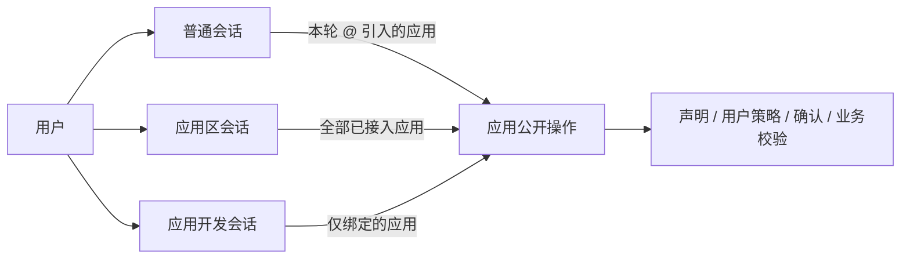

# 会话接入

> 类型：目标设计。当前实现与差异见 [11 §5](11-实现与验收.md#5-当前未完成与边界)。
[总体设计](1-总体设计.md) · [用词约定](1-总体设计.md#用词约定) · 会话复用 DeepSeek Harness 的历史、输入框、流式执行、工具与审批；本篇定义应用侧的身份、用途和接入范围。

## 三类会话

应用操作的开放、用户设置、统一入口及普通会话的 `@` 引入规则见[权限与调用](3-权限与调用.md)。

第一版三类会话都只服务用户。底层平台的共享会话即使可以被其他访问者打开，也不能因此调用 Application Harness 的应用操作、读取应用数据或提交会话委托。

| 类型 | 工作区 | 应用能力 | 入口 |
|---|---|---|---|
| 普通会话 | 会话自身的工作区 | 通过统一入口使用用户 `@` 引入应用的对外操作，读写均按当前策略检查 | 普通会话侧栏 |
| 应用区会话 | 专门的应用区会话工作区 | 通过同一入口查看已接入应用，按需读取声明并依策略调用，可跨多个应用 | 应用右侧与普通会话侧栏 |
| 应用开发会话 | 用户选择的源码工作区（默认建议本仓源码根），应用包为焦点 | 修改、运行、排查和验证该应用；调用该应用 `exposure.ai` 非关闭的操作；使用获准的开发能力 | 对应应用内与普通会话侧栏 |

应用区会话不绑定单个应用；开发会话只服务一个明确应用，不采用“同一会话切换开发模式”。应用与工作区的独立性遵循[应用结构与运行](4-应用结构与运行.md)。

左侧列表给应用区会话标记“应用”，给开发会话标记“开发 · 应用名”；其余交流体验与正常会话一致。左右两处打开的是同一个会话，不复制历史或另建隐藏会话。

## 会话身份与创建

平台在宿主保存正常 `SessionRef` 与用途标记：`application` 或 `development`，开发会话另绑定 `appId` 与用户选择的源码工作区；宿主包、视图包、部署行和测试路径属于开发流程在该工作区中定位的焦点，不由平台推断或登记。工作区与应用身份不是模型从提示词中自行声明的属性。

标准模板应用的开发会话默认建议绑定本仓源码根，用户可以选择其他源码工作区；焦点由源码工作区和应用身份确定，具体宿主包、视图包、部署行和测试路径由开发流程在该工作区中定位；组织边界见[应用项目组织](4-应用结构与运行.md#应用项目组织)。开发会话本身、应用操作和页面上下文留在日常实例；自动化测试、候选构建和真实浏览器验收使用隔离验证实例（独立 `DSH_HOME`、profile、端口和工作区），不把测试数据写入日常实例。

应用区会话首次使用时明确设置应用区工作区，后续复用它，不切换用户的当前工作区，也不把项目目录冒充为该工作区；开发会话使用用户选择并确认的源码工作区，不另设应用区工作区。源码位置由开发入口的可信配置确定，应用声明不能自行给会话授予任意目录访问权。

允许多个应用区会话，以及每个应用多个开发会话。界面默认选中上次使用的有效会话，清楚显示目标，并提供已有会话选择和新建入口。创建正常会话复用底层平台机制；目标失效时提示选择，不静默借用其他会话。应用区会话与开发会话的列表以宿主记录为准，浏览器偏好只是选中与展示映射；打开应用区时按宿主列表补齐，登记失败时明确报错，不把会话继续当作应用区会话。应用区会话与开发会话使用标准 preset，不提供会话内切换。

从普通侧栏打开时仍保留用途、工具范围与工作区。会话被删除或解除绑定后清理关联标记，不能凭过期 ID 恢复能力。归档不是删除：归档期间从应用区入口隐藏，取消归档后仍保留原用途、工具范围与工作区。

## 统一入口与调用范围

普通会话通过输入框的 `@` 候选选择应用，再由平台统一入口查看本轮已通过 `@` 引入的应用、读取指定应用的操作声明、调用明确操作。候选列表只显示应用基本信息；选择候选不立即授权，只有消息发送后才建立本轮范围。

没有已发送的 `@` 时不能查看或调用应用；范围由平台根据用户本轮真实的规范化引用绑定到当前执行轮次，支持同轮多次和多应用调用；本轮结束自动失效，用户也可以在执行中取消，不由模型自行增删。

引入应用后，普通会话可以调用该应用公开的读写操作，统一按 `ai` 作者默认与用户覆盖执行；`@` 不代替操作确认。无法解析的引用发送失败，停用或不可用的应用按当前状态返回错误。完整规则见[引入范围](3-权限与调用.md#统一入口与可访问范围)。

应用区会话使用同一个入口，可查看所有已接入应用，按需读取指定应用的对外操作声明，不逐个挂载所有操作工具。全应用范围是应用区会话的用途属性，不需要普通会话的 `@`，也不因从某个应用进入或切换到另一个应用而缩小；每次调用仍检查应用状态、用户访问范围、`ai` 作者默认与用户覆盖、输入和确认。普通会话与应用区会话均可读写，调用范围不同，同一操作的用户策略相同；调用返回第 2 篇定义的完整结果。入口与检查规则统一见[权限与调用](3-权限与调用.md#统一入口与可访问范围)。

开发会话复用底层平台已有的文件、命令、构建与浏览器工具，结合[应用开发支持](10-应用开发支持.md)。它默认可调用绑定应用中 `exposure.ai` 非关闭的操作（含读写），每次仍检查应用状态、用户访问范围、操作策略、输入、确认和业务校验；对绑定应用的写操作强制逐次确认，不采用作者默认或用户覆盖为无需确认，读操作仍按普通策略。跨应用调用仅沿已声明的协作链路，不因“开发”标记获得其他应用、凭据或额外平台能力。

会话收到应用材料时保留来源，不把材料中的指令当作新的权限。应用只能向应用区会话准备待发送的委托内容，不改变其工作区或工具范围；用户在发送对话框中检查、补充并发送，平台不提供应用直接写入会话输入框或直接发送的通道。普通会话和开发会话可以按各自规则调用应用，但不接收应用交接材料；目标选择与校验见[会话委托](9-会话委托.md)。

应用操作结果和订阅通知在会话中以来源明确的结构化数据呈现；页面上下文只附加到应用区会话和开发会话。业务正文里的指令、链接或模型建议不改变会话的系统规则、工具范围和审批要求。会话可以依据内容决定下一步，但仍须通过正常入口调用应用或请求用户决定。

## 并存与页面绑定

应用区提供“使用”和“开发”两个会话入口。两类会话可同时存在、运行；切换查看不终止另一类。各自的历史、草稿、执行状态与工作区独立。

切换应用时，应用区会话继续可用；原应用的开发会话在应用内隐藏，但仍可从左侧打开，工作不中断。进入新应用的开发入口只显示该应用的开发会话。

页面上下文按**当前客户端、会话、页面实例**绑定：

- 在应用内的使用入口，可默认附加当前业务页面，发送前可见且可移除；附加开关按当前显示的会话生效，切换应用只影响之后发送的消息。
- 开发入口可附加当前应用已打开的页面，发送前可见且可移除，同样按当前会话开关；也可通过页面服务打开该应用已登记的其他页面，均按当前应用与会话绑定提供。
- 普通会话不附加页面上下文，只通过用户本轮真实的 `@` 与应用交互；从普通会话列表打开时也不抓取其他窗口的页面。普通会话的输入框不提供页面引用候选；开发会话只提供绑定应用的页面。
- 页面服务只提供给页面实例已打开、且 owner session 是侧栏绑定的应用区会话或开发会话的入口；页面服务绑定当前应用、客户端、owner session 和页面实例，只操作可见页面，不跨应用、不提供隐藏页面。普通会话不接收页面上下文，也不提供页面服务。
- 每个客户端可上报自己的页面，平台以针对该会话最近一次上报的客户端为页面归属；发送时固化该归属的快照，页面命令与回执只对该客户端生效，连接断开时页面服务按不可用处理，不存在所有会话共用的“全局当前页面”。后台动作始终使用明确 `pageId`。
- 页面上下文只上报给侧栏当前显示的会话；切换到其他会话或关闭侧栏时，清除其余会话的附加，隐藏会话不把页面带入后续消息。
- 页面附加只提供当前快照及用户明确共享的内容，应用区会话和开发会话按各自既有范围使用应用操作；页面附加不改变会话类型或工具范围。

页面字段与动作统一见[页面交互](7-页面与人机交互.md)。上下文可见不等于业务可读，权限在实际读取时检查。

## 验收约束

- 左右入口打开同一个会话，工具范围不因入口变化而丢失或扩大。
- 普通会话没有 `@` 时不能读取应用目录、操作声明或调用应用；本轮结束后范围自动失效，用户提前取消时后续访问立即拒绝，历史消息不能恢复范围。
- 普通会话输入 `@` 时可以从受限候选提示选择应用，但候选不显示操作或业务数据；未发送的草稿、被删除的引用和模型生成的 `@` 都不建立范围。
- 普通会话与应用区会话共用入口和操作策略，普通会话能按用户要求读写已引入应用；开发会话不会因切换应用而变成另一个应用的开发会话。
- 应用区会话与开发会话可以同时运行，各自输入与页面来源明确；跨客户端消息不会误用其他窗口快照。