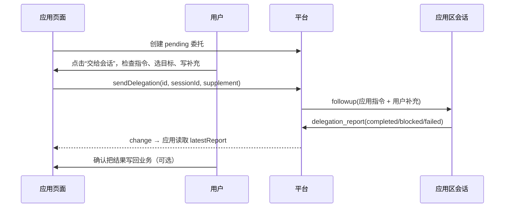

# 会话委托

> 类型：目标设计。当前实现与差异见 [11 §5](11-实现与验收.md#5-当前未完成与边界)。

相关协议见[统一 JSON 协议](2-统一JSON协议.md)，会话身份见[会话接入](8-会话接入.md)。
[总体设计](1-总体设计.md) · [用词约定](1-总体设计.md#用词约定) · [权限与调用](3-权限与调用.md) · [应用互联](6-应用互联.md)

本篇定义应用如何把一件准备好的工作显式交给用户使用的应用区会话，并把最新结果读回应用。委托是**应用业务对象 + 平台发送通道**，不是同步业务函数，也不是平台队列。

## 首版边界

- 应用创建 `pending` 委托；用户选择或新建应用区会话、检查指令、可写一段补充，然后显式发送。
- 应用声明 `delegate` 能力并获得用户授权后，才能创建、读取或取消自己的委托记录；未声明返回 `app.capability-undeclared`，未授权返回 `app.capability-not-approved`。发送不受这个能力门影响，仍由用户完成。
- 平台把“应用指令 + 用户补充”作为一条普通 user 消息送入目标会话，并在执行开始时注入一次可信委托上下文与 `delegation_report` 工具；上下文不按步重复写入会话。
- 会话通过该工具回报 `completed` / `blocked` / `failed`；平台只保存**最新**一次回报。
- 应用通过自己的公开操作读取委托状态/结果；平台状态变化发应用 change，页面 `onChanged` 后重读。接受最终一致。
- 平台不保存回报历史，不承诺重放、恰好一次、自动续跑或跨应用事务。
- 应用不能自动发送、不能读会话正文、不能指定工具/preset；用户补充不回传应用。

## 状态与字段

状态：

- `pending`：应用已创建，等待用户发送；
- `active`：用户已发送，会话执行中；
- `needs-person`：会话回报 `blocked`，需要用户回答；
- `ended`：结束，`outcome` 为 `completed` / `failed` / `cancelled` / `interrupted` / `unavailable` 之一。

字段：`id`、`appId`、`title`、`instructions`、`status`、`sessionId`、`latestReport`、`createdAt`、`updatedAt`。`latestReport` 为 `{ outcome, summary, question?, details? }`；`blocked` 必须带 `question`，`details` 必须是 JSON 对象且有大小上限。

## 流程

应用创建委托的内容由应用生成，用户只读不可改写；用户补充只进入会话消息，不写回委托记录，也不自动回传应用。

## 发送规则

- 目标只能是已注册的应用区会话；普通会话、开发会话被拒绝。
- 选择目标时展示会话标题与可用状态；不可用目标在发送前明确标示，发送时仍按当前状态拒绝，不猜测替代目标。
- 用户显式发送；平台不能由定时任务、订阅通知、模型输出、后台工作或记住的目标自动发送。
- 发送时对“指令 + 补充”做快照；之后应用业务数据变化不影响运行中的委托。
- 目标会话正在跑普通轮次时，委托消息按普通 user 消息排队；会话已有活跃委托、不可用或目标非法时拒绝，用户另选或稍后重试。
- 一个执行会话同一时间一个活跃委托由平台保证；同一业务对象一个活跃委托由应用保证，平台不按业务对象去重。
- 补充说明有长度上限；超限拒绝，空白视为未提供补充。

## 回报

`delegation_report` 只接受绑定会话的调用：

- `completed`：结束并保存 summary；
- `failed`：结束并保存可读原因；
- `blocked`：转 `needs-person`，必须带具体 question；用户回答后会话继续，后续回报覆盖最新结果。

同一报文重试幂等；未知/非法报文拒绝。平台只存最新结果，不保存历史。

## 结果到应用

- 应用通过公开操作读取自己的委托列表/单条委托；不能读别的应用的委托。
- 平台在状态/回报变化时发应用 change；页面 `onChanged` 后重读。
- 接受最终一致：页面关闭时结果可能不同步，下次打开/重连读取最新。
- 用户回答后委托状态保持 `needs-person`，直到会话下一次回报覆盖最新结果；应用和界面读到的是最近一次回报，不能据此推断用户是否已回答，也不把等待中的提问当作已完成。
- 应用不能读会话正文；只能拿最新回报与状态。
- 结果写入业务必须由应用公开操作完成，并遵守应用自己的权限、版本和确认规则；模型输出不自动写入，不自动把待办标完成。

## 打开执行

- 平台提供 `openDelegation(id)` 客户端动作：校验委托属于当前应用，再打开绑定会话；应用不能打开任意会话。
- 应用管理“委托”页签也提供打开执行入口。
- `needs-person` 时，应用页面与管理页展示最近回报的问题和明确的打开会话入口，用户回答在会话中完成；平台不代替用户回答，也不自动结束委托。
- 会话不可用/已结束/已删除时返回明确错误，不猜测目标。

## 重启与取消

- 宿主重启时，`active`/`needs-person` 的委托标为 `interrupted`，不自动重发、不自动续跑。
- 用户或应用可以取消 `pending`/`active` 委托；取消结束记录，不强制中断会话轮次，也不回滚会话已经产生的效果。
- 已结束的委托不能重发；需要时新建委托。

## 验收约束

- 应用按钮只创建 pending；发送始终由用户检查后确认。
- 定时任务、订阅通知、模型输出、后台工作和记住的目标不能自动发送或创建会话。
- 只能选择应用区会话；普通/开发会话与已删除目标被拒绝。
- 发送前能看见来源、目标、指令；用户可写补充，但不能改写应用指令。
- 会话忙时普通轮次排队；已有活跃委托/不可用时拒绝。
- 回报只接受信封字段；`blocked` 有具体问题；没有回报不显示成功。
- 结果不自动写入业务；用户确认后由应用操作追加；未知/失败不重试、不重复写。
- 重启后中断状态如实显示；应用不能读 transcript，不能打开任意会话。
