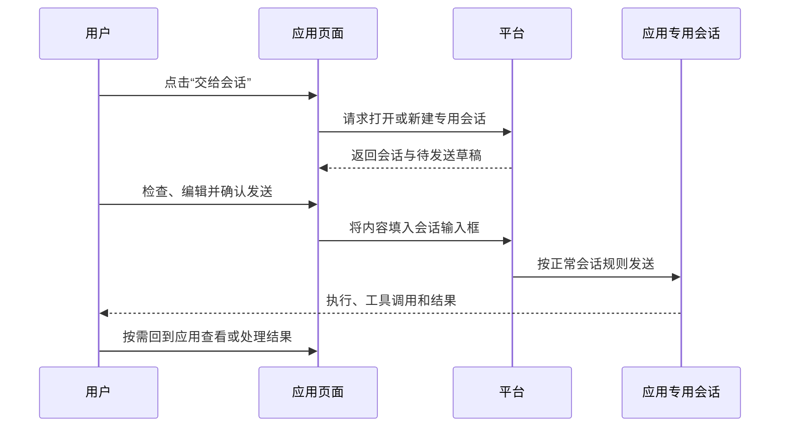

# 会话委托

[总体设计](1-总体设计.md) · [用词约定](1-总体设计.md#用词约定) · 本篇定义应用如何把准备好的工作交给用户使用的应用专用会话。公共数据见[统一 JSON 协议](2-统一JSON协议.md)，会话身份与绑定见[会话接入](8-会话接入.md)。

## 首版边界

首版只提供简单的人机交接：应用准备一份待发送内容，用户选择或新建应用专用会话，平台打开会话并填入内容，用户检查后按回车发送，会话再按正常规则执行。点击应用按钮不能直接代替用户发送；定时任务、订阅通知、模型输出、记住的目标和预先绑定也不能自动提交。

这条路径适合需要模型继续分析、整理或调用工具的工作，同时保留用户对目标会话、材料和最终发送动作的控制。平台不把会话伪装成同步业务函数，也不在首版承诺结构化异步结果回传、自动取消、自动续跑或跨应用恰好一次执行。应用需要业务结果时，通过会话记录或自己的公开操作查询和处理。

## 交接流程

应用页面在明确业务入口中准备：

- 目标说明和可读的来源说明；
- 必要的 `ObjectRef` 或文本上下文；
- 用户可以检查和编辑的 prompt；
- 目标应用专用会话的当前选择，以及新建入口。

随后按以下流程执行：

平台必须在发送前清楚展示来源应用、目标会话、材料摘要和待发送内容。用户可以移除材料、修改文字或更换目标；修改后的内容仍是普通会话输入，不能成为系统指令、权限声明或工具授权。没有明确目标时，平台先让用户选择或新建，不在后台擅自创建或改选。

目标只能是用户可访问的应用专用会话。普通会话和应用开发会话不接收应用准备的委托材料；页面服务也不能借此跨应用或改变会话工具范围。目标会话忙时保留草稿并提示用户另选会话或稍后发送，不排队、不打断、不自动补交。

## 权限与材料

本次交接由用户在页面中发起，平台在可信调用上下文中绑定来源应用、用户和目标会话。这个决定只覆盖本次发送，不成为应用的长期权限，也不能由业务 JSON 中的标记伪造或被后台工作复用。会话执行时仍使用自身的工作区、工具、模型配置和审批规则；应用不能通过 prompt、上下文或对象引用要求跳过确认、访问未授权资源或自动调用其他应用。

材料内容按不可信数据处理。读取 `ObjectRef` 或应用数据时，目标会话和应用仍按当前权限及对象状态检查。平台不把页面上下文、对象正文或凭据自动复制到会话，页面只共享用户明确确认的内容。

## 结果与业务处理

会话按正常聊天规则运行，结果首先属于会话记录。应用页面可以提供“查看会话”“回到应用”或应用自己的查询入口，但关闭页面不改变已经发送的消息。应用需要把结果写入业务数据时，必须由应用公开操作完成，并再次遵守应用权限、冲突和确认规则；模型输出本身不自动写入业务数据，也不自动触发跨应用调用。

应用可以在 prompt 中约定可读的输出格式，也可以让用户把会话结果复制或通过应用操作提交。格式不符合预期、对象已删除、权限变化或结果未知时，应用显示明确状态并由用户决定后续动作，不把未知当成功，不自动重试或重复写入。平台不保存一套独立的委托结果记录，也不承诺应用结果一定回到原页面。

## 后续扩展边界

如果以后出现需要后台异步处理、结构化结果投递、取消、结果重放或可靠关联的真实场景，可以在本篇简单交接路径之上另行设计协议。届时需要重新确定持久记录、幂等、终态、结果归属和数据保留规则，不以首版的页面草稿语义推导这些保证。

## 验收约束

- 应用按钮只打开或准备专用会话；发送始终由用户检查后确认。
- 定时任务、订阅通知、模型输出、后台工作和记住的目标不能自动发送或创建会话。
- 只能选择用户可访问的应用专用会话；普通会话、开发会话和其他应用会话会被拒绝。
- 发送前能看见来源、目标和材料；修改、移除或更换目标后按修改后的内容发送。
- 会话忙时不排队、不打断、不自动重试，待发送内容仍可由用户处理。
- 关闭页面后已发送消息仍按会话规则执行；结果处理由用户或应用自己的公开操作完成。
- 会话内容不扩大权限，不把模型输出自动写入业务数据，不把未知结果当作成功。
